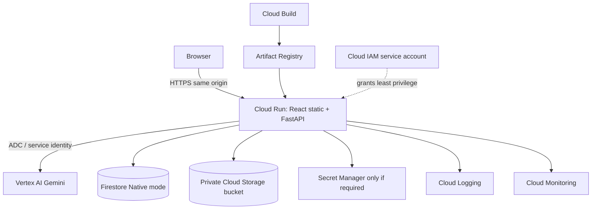

# 02 — Google Cloud Target Architecture

## 1. Non-negotiable deployment boundary

The browser loads the application from a Cloud Run HTTPS URL. Cloud Run serves the compiled React application and the FastAPI API from the same origin. All model inference and persistent state access happen from the backend using Google Cloud APIs. The browser never calls Vertex AI, Firestore or Cloud Storage directly.

## 2. Architecture diagram

## 3. Service choices and responsibilities

| Google Cloud service | Required? | Use |
|---|---:|---|
| Cloud Run | Yes | One containerized app: React static build + FastAPI |
| Vertex AI | Yes | Gemini model inference using Google Gen AI SDK in Vertex mode |
| Firestore Native mode | Yes | Graph nodes/edges, demo principals, policies, workflow state, agent versions, approvals, evolution, audit |
| Cloud Storage | Yes | Synthetic incident files, evidence images, generated report artifacts |
| Cloud IAM | Yes | Dedicated Cloud Run service account and least-privilege permissions |
| Artifact Registry | Yes | Store immutable container image |
| Cloud Build | Yes | Build, test and deploy pipeline |
| Cloud Logging | Yes | Structured application logs |
| Cloud Monitoring | Recommended | Cloud Run health, latency, errors and basic alerts |
| Secret Manager | Conditional | Only for secrets not replaced by service identity; never store public frontend secrets |

Do not add Cloud SQL, Memorystore, Pub/Sub, GKE, BigQuery, Firebase Hosting or external services for this prototype.

## 4. Model access

Use `google-genai` with Vertex AI mode. Configure project and region via environment variables. The Cloud Run service account obtains credentials through Application Default Credentials. No Gemini API key is embedded in code, `.env`, frontend bundles or browser requests.

Model ID must be configured in `VERTEX_GEMINI_MODEL`; do not hardcode model IDs across the codebase. Before build, verify the selected model is available in the chosen Vertex AI region and project quota is enabled. Use one selected model for the prototype; the provider adapter interface is the only model-independence proof in this build.

## 5. Firestore graph design

Firestore is document-oriented, not a native graph database. Do not pretend it is Neo4j. Store canonical graph data as documents and implement a bounded graph resolver in the backend:

- `graph_nodes/{node_id}`
- `graph_edges/{edge_id}`
- `graph_meta/current` (graph version, last seed timestamp)

At application startup or first route request, load only active graph records for the demo tenant into a bounded adjacency structure. Cache in-process for a short TTL (for example 30 seconds). For every route resolution, evaluate principal and policy against candidate edges and nodes. On graph updates, increment `graph_meta.version`; refresh cache when version changes. Do not load unbounded collections. For this small seeded graph, bounded full load is acceptable; set a hard maximum of 250 nodes and 800 edges for the prototype.

Firestore remains canonical. In-memory graph is a disposable derived cache, never the source of truth. Every node/edge mutation is performed through backend services and logged.

## 6. Cloud Storage design

Use one private bucket with a prefix convention:

`gs://{bucket}/demo/{tenant_id}/{task_id}/inputs/{file_name}`
`gs://{bucket}/demo/{tenant_id}/{task_id}/outputs/{file_name}`

The bucket must not be public. The backend issues uploads/downloads or proxies file operations. For the MVP, use backend upload endpoint and bounded file size. Store object URI, content type, checksum, uploader principal, classification and task association in Firestore. Never put a permanent public object URL in the UI.

## 7. Cloud Run configuration

- One Cloud Run service: `lara-runtime`.
- One region chosen after confirming Vertex AI model availability and Firestore/GCS location strategy. Prefer a nearby supported region; do not assert residency until verified.
- Container listens on `$PORT` (default 8080).
- Set min instances to 0 unless cold-start risk requires 1 and budget allows.
- Set max instances to a small safe cap for the demo (for example 2).
- Set concurrency conservatively (for example 20) until tested.
- Configure request timeout to fit bounded Gemini workflows; use explicit per-model timeout.
- Use a dedicated runtime service account.
- Public ingress may be allowed for the jury demo, but the application itself must require seeded demo login/session for protected routes. Public service URL does not mean public data access.
- Use secure, HTTP-only, SameSite cookies for demo session where feasible; validate CSRF for state-changing browser requests.

## 8. IAM baseline

Create a dedicated Cloud Run runtime service account. Grant only required roles:
- Firestore access scoped to the project/database (prototype may require Datastore User role; validate exact API permissions).
- Storage Object Creator/Viewer as needed for the private demo bucket; avoid Storage Admin at runtime.
- Vertex AI User for inference.
- Secret Manager Secret Accessor only for named secrets if any are used.
- Logging writer permissions as needed (Cloud Run normally writes platform logs; application structured logging goes to stdout).

Do not run Cloud Run as the default broad editor/owner identity. Build/deploy principal and runtime service account must be separate. Never ship service-account JSON keys. Use attached service identity / ADC.

## 9. Deployment flow

1. Enable required APIs.
2. Create Firestore Native database in selected region.
3. Create private Cloud Storage bucket.
4. Create runtime service account and grant minimum roles.
5. Create Artifact Registry Docker repository.
6. Build frontend assets.
7. Run backend and frontend tests in Cloud Build.
8. Build container and push to Artifact Registry.
9. Deploy image to Cloud Run with runtime service account and environment configuration.
10. Run `/health/ready` and smoke tests against deployed URL.
11. Seed demo data through an authenticated admin-only seed command or controlled one-time job executed within Google Cloud; do not require laptop database access at demo time.
12. Verify browser, model call, Firestore read/write, GCS upload, graph route and audit persistence.

## 10. Region and quota gate

Do not guess region availability. Before deployment, verify:
- Vertex AI Gemini model availability in target region.
- Firestore database location and Cloud Run region compatibility/latency.
- Cloud Storage bucket location.
- Event project quotas and billing state.

Use one region for Cloud Run, Firestore and bucket where supported. Vertex AI may require a supported location configuration; follow current Vertex AI regional/global endpoint rules. Document the selected values in `.env.example` and deployment output.

## 11. Failure behaviour

- Vertex AI unavailable: return controlled `MODEL_UNAVAILABLE`; do not fake a completed AI result.
- Firestore unavailable: fail closed for protected routes and writes; no in-memory permissive fallback.
- Graph cache stale: refresh from Firestore; if refresh fails, return `ROUTE_RESOLUTION_UNAVAILABLE`.
- Missing principal: reject protected operation.
- Policy engine error: deny protected operation.
- Cloud Storage read failure: mark evidence unavailable and do not invent content.

## 12. References

Use current official Google documentation during implementation:
- Cloud Run + Google Cloud service identity: https://docs.cloud.google.com/run/docs/integrate/using-gcp-services
- Cloud Run secrets: https://docs.cloud.google.com/run/docs/configuring/services/secrets
- Cloud Build deploy to Cloud Run: https://docs.cloud.google.com/build/docs/deploying-builds/deploy-cloud-run
- Artifact Registry + Cloud Run: https://docs.cloud.google.com/artifact-registry/docs/integrate-cloud-run
- Firestore data model: https://firebase.google.com/docs/firestore/data-model
- Google Gen AI SDK: https://googleapis.github.io/python-genai/
- Vertex AI Gen AI SDK reference: https://docs.cloud.google.com/python/docs/reference/vertexai/latest
