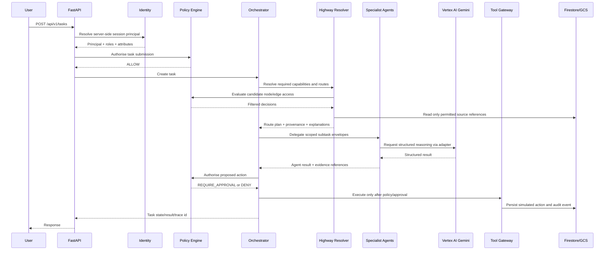

# 03 — Backend Workflow and Runtime Specification

## 1. Backend shape

Build a **modular monolith** in FastAPI. Logical modules must be separate; deploy as one Cloud Run service. Do not create microservices.

```text
backend/app/
  main.py
  core/{config.py,errors.py,logging.py,security.py}
  api/routes/{auth.py,tasks.py,graph.py,agents.py,evolution.py,policies.py,approvals.py,audit.py,health.py}
  identity/{models.py,principal.py,session.py}
  policy/{engine.py,rbac.py,abac.py,delegation.py}
  graph/{models.py,firestore_repository.py,cache.py,resolver.py,ranker.py,explain.py}
  orchestration/{planner.py,runner.py,state_machine.py,context.py}
  agents/{base.py,registry.py,research.py,analysis.py,verification.py}
  models/{base.py,vertex_gemini.py,router.py,schemas.py}
  evolution/{collector.py,diagnosis.py,candidate.py,evaluator.py,versions.py,promotion.py}
  tools/{registry.py,gateway.py,validators.py,simulated_connector.py,calculator.py}
  approvals/{service.py,models.py}
  audit/{service.py,models.py}
  storage/{firestore.py,gcs.py}
```

Names may be adapted only if the same boundaries remain. Person A owns the entire backend tree.

## 2. Main execution lifecycle



## 3. Workflow state machine

Allowed states:

`QUEUED → PLANNING → ROUTING → DELEGATING → VERIFYING → AWAITING_APPROVAL → EXECUTING → COMPLETED`

Failure/cancellation states:

`FAILED`, `CANCELLED`, `BLOCKED_POLICY`, `NEEDS_INPUT`.

Rules:
- Every transition is performed by backend service and persisted.
- Invalid transitions return 409.
- Every transition emits an audit event.
- A retry creates a new attempt identifier; it does not overwrite previous trace history.
- A task in `BLOCKED_POLICY` cannot proceed unless a new authorised request is created.
- An approval does not rewrite the original task principal; it records a separate approver principal.

## 4. Task planner

The planner receives:
- Task text.
- Principal context (minimum required fields).
- Allowed capability catalogue.
- Policy constraints.
- Current agent/skill versions.

It returns schema-validated JSON:

```json
{
  "objective": "Investigate incident INC-204 and prepare a response",
  "required_capabilities": ["incident_research", "asset_context", "procedure_check", "verification"],
  "subtasks": [
    {"id":"st-1","agent_id":"research_agent","purpose":"Collect permitted incident and asset evidence","depends_on":[]},
    {"id":"st-2","agent_id":"analysis_agent","purpose":"Analyse evidence and draft response","depends_on":["st-1"]},
    {"id":"st-3","agent_id":"verification_agent","purpose":"Check claims, sources and policy constraints","depends_on":["st-2"]}
  ],
  "proposed_actions": ["maintenance_request.create_simulated"]
}
```

The planner cannot grant permission. The backend validates agent IDs, skills, dependency references, allowed tools and maximum plan size. If model output is invalid, retry once with schema correction, then fail safely.

## 5. Specialist agent contracts

All agents implement the same interface:

```python
class Agent:
    agent_id: str
    async def execute(self, task: AgentTask, context: AuthorizedContext) -> AgentResult: ...
```

`AgentTask` includes task ID, subtask ID, delegated principal, allowed source IDs, allowed tool IDs, purpose, deadline and version IDs. `AuthorizedContext` contains only data already authorised and retrieved by the runtime. Agents never receive database credentials or arbitrary graph query access.

### Research Agent
- Purpose: discover relevant permitted information and produce evidence bundle.
- Inputs: incident ID, allowed source references, search intent.
- Outputs: facts, source IDs, source locations, freshness, uncertainty.
- Forbidden: read restricted sources; create actions; modify graph; approve.

### Analysis Agent
- Purpose: analyse research evidence, identify likely causes and prepare a response proposal.
- Inputs: Research Agent result and authorised context.
- Outputs: analysis, hypotheses, confidence rationale, recommended next steps, proposed action.
- Forbidden: claim unsupported facts; access new sources without route re-resolution; execute action.

### Verification Agent
- Purpose: check evidence coverage, citation validity, contradictions, SOP revision, uncertainty and policy constraints.
- Inputs: proposed analysis and source metadata.
- Outputs: pass/fail findings, unsupported claims, missing evidence, correction requests.
- Forbidden: approve actions; change permissions; modify agent versions.

## 6. Model adapter

Define a provider-independent interface, but implement only Vertex AI Gemini.

```python
class ModelProvider(Protocol):
    async def generate_structured(self, *, model: str, system_instruction: str,
        user_content: str, response_schema: dict, trace_id: str) -> dict: ...
```

The Vertex adapter:
- Uses `google-genai` in Vertex AI mode.
- Uses Cloud Run ADC/service identity.
- Reads project, location and model from server configuration.
- Enforces timeouts and bounded output tokens.
- Logs model ID, latency, token usage where available, status and trace ID—not secrets or full sensitive prompts.
- Validates output with Pydantic after model generation.
- Treats all model output as untrusted proposals.

No direct model SDK calls from agents or routes; all calls go through the adapter.

## 7. Tool gateway

All tools are registered with:
- `tool_id`, description, input schema, output schema.
- Required action permission.
- Allowed roles/attributes/purpose.
- Risk level (`READ`, `LOW`, `CONSEQUENTIAL`, `PROHIBITED`).
- Whether approval is required.
- Whether tool is simulated.

Required MVP tools:
- `source.read_authorized` — read only after route and policy checks.
- `calculator.safe` — bounded arithmetic over validated numeric inputs; no eval/exec.
- `maintenance_request.create_simulated` — writes a simulated request record to Firestore; requires Supervisor approval.
- `equipment.control` — always DENY / unsupported.

Tool execution sequence:
1. Validate tool ID and JSON arguments.
2. Resolve originating principal and delegation chain.
3. Evaluate RBAC + ABAC policy.
4. If `DENY`, do not execute.
5. If `REQUIRE_APPROVAL`, create approval record and pause workflow.
6. On approval, re-evaluate policy and ensure approval is valid, not expired and by a distinct authorised principal.
7. Execute tool in bounded implementation.
8. Persist output and audit event.

## 8. Context assembler

Only accepts authorised source payloads and metadata. Maximum context is bounded by configured token budget. Preserve source ID, title, source revision, location/page, retrieved timestamp and classification. Do not place rejected source content in model context. Do not include secret fields or unnecessary PII.

## 9. Error model

Return stable errors:
- `AUTH_REQUIRED` 401
- `FORBIDDEN` 403
- `POLICY_DENIED` 403
- `APPROVAL_REQUIRED` 202 / task waiting state
- `NOT_FOUND` 404
- `INVALID_STATE_TRANSITION` 409
- `VALIDATION_ERROR` 422
- `MODEL_UNAVAILABLE` 503
- `ROUTE_RESOLUTION_UNAVAILABLE` 503
- `INTERNAL_ERROR` 500

Do not return stack traces or secrets to the browser. Include `request_id` and `trace_id`.

## 10. Persistence

Firestore stores workflow/task documents, task event subcollections, principals, roles, policy records, agent definitions, agent versions, evolution proposals, evaluation results, approvals and audit events. Cloud Storage stores evidence objects. Graph nodes/edges are stored in dedicated collections. See the schema document sections in `04_INFORMATION_HIGHWAYS_SPEC.md` and `09_API_CONTRACT.md`.
