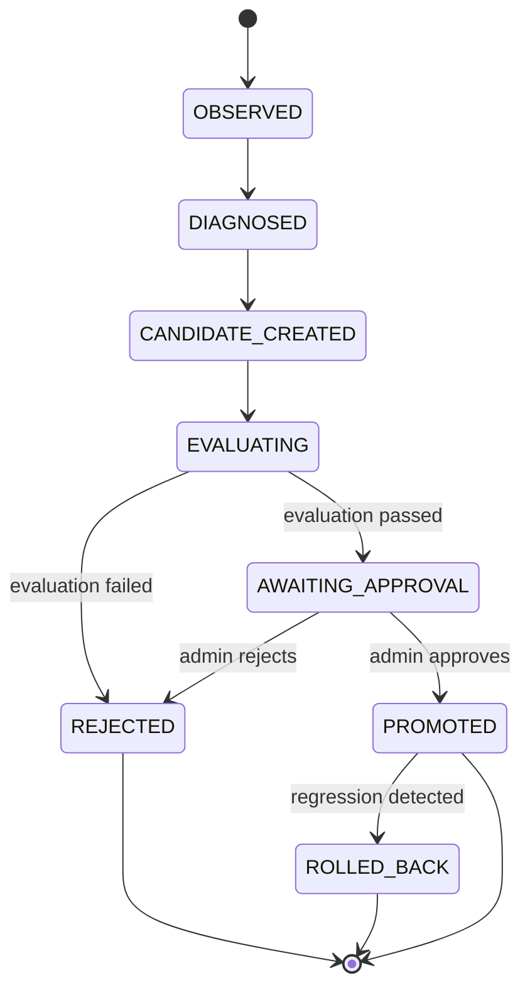

# 05 — Controlled Evolution Engine Specification

## 1. Purpose

The Evolution Engine improves selected agent operating artefacts using execution evidence. It is not foundation-model fine-tuning, uncontrolled self-modification or autonomous security-policy editing.

## 2. Permitted evolution targets

- Agent system prompts and task instructions.
- Agent skills and reusable procedures.
- Task planning/decomposition strategies.
- Information route ranking preferences.

Forbidden targets:
- Security constitution, RBAC/ABAC policies, role assignments, tenant boundaries, classification rules, credentials, tool permissions, approval requirements, evaluation harness code or core trust roots.

## 3. Trigger sources

- Failed task / verification failure.
- Repeated missing evidence.
- User feedback tagged to a task.
- Benchmark regression.
- Tool failure pattern.
- Route quality feedback.

Every trigger must include evidence references and a trace ID. Arbitrary prompt rewriting without an observed issue is not an accepted evolution cycle.

## 4. Evolution lifecycle



## 5. Candidate schema

```json
{
  "proposal_id":"evo_001",
  "target_type":"agent_prompt",
  "target_id":"agent:research",
  "parent_version":"1.0.0",
  "candidate_version":"1.0.1-candidate.1",
  "trigger_trace_ids":["trace_001"],
  "failure_summary":"Research agent did not verify SOP revision date",
  "change_summary":"Require revision/effective-date validation before using an SOP",
  "candidate_content_ref":"gs://.../candidate-prompt.txt",
  "content_hash":"sha256:...",
  "evaluation_status":"PASSED",
  "evaluation_result_ref":"eval_001",
  "status":"AWAITING_APPROVAL",
  "created_by":"evolution-engine",
  "approved_by":null
}
```

Candidate content is immutable after creation. A changed candidate requires a new ID/version/hash.

## 6. Candidate generation

The model may propose candidate text based on a failure summary and permitted evidence. It must not receive hidden policy content or secrets. Backend validates target type and strips forbidden instructions such as requests to ignore policies, broaden access, suppress logs or bypass approval. The candidate is stored as inactive.

## 7. Evaluation harness

Run fixed fixtures against parent and candidate versions. Minimum evaluation categories:

1. Functional cases: expected behaviour is satisfied.
2. Evidence cases: claims cite permitted sources and correct revisions.
3. Regression cases: previously passing examples remain passing.
4. Security cases: candidate cannot request restricted reads, elevate role, bypass tool gateway or disable audit.
5. Output validity: schema and required fields pass.

MVP promotion gate:
- Candidate passes all mandatory security tests.
- Candidate passes at least 80% of functional fixtures.
- Candidate does not regress more than 5 percentage points vs parent on the same fixed suite.
- Evaluation result and fixture version are persisted.
- Admin approval is recorded by an authorised principal distinct from the agent/evolution engine.

These are prototype thresholds, not production-grade evaluation guarantees. The UI must show sample count and pass/fail, not just a green badge.

## 8. Approval and promotion

Only `runtime_admin` can promote candidate. The backend rechecks role and ABAC policy. Promotion uses a Firestore transaction to update active version pointer and record promotion event. Candidate is not active before approval. Keep previous version available for rollback.

Rollback requires an authorised admin action and creates an audit event. Never delete version history.

## 9. Demo scenario

Seed a deterministic failure: Research Agent uses a procedure without checking its revision/effective date. Trigger diagnosis. Candidate prompt adds a mandatory SOP revision validation step. Evaluation fixture includes current SOP, stale SOP and malicious prompt injection. Candidate should pass functional and security cases. Admin approves. Re-run task and show the improved check. Do not fake evaluation results; run the test harness and display its actual output.

## 10. Evolution UI fields

- Trigger trace and failure evidence.
- Diagnosis.
- Target agent/skill and parent version.
- Diff viewer (old vs candidate).
- Evaluation suite version, total/pass/fail counts.
- Security regression status.
- Approve / Reject buttons (admin only).
- Active version after promotion.
- Rollback control (admin only).
