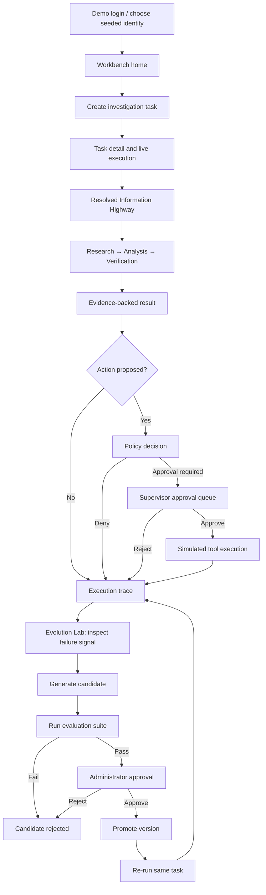

# 08 — UX Flow and Screen Specification

## 1. Product design direction: Bright Lattice

Use the supplied reference image and the included design assets. The visual language is high-energy, geometric, flat-colour, playful but structured. It must not become a conventional dark cyber dashboard.

### Palette roles

| Colour | Role | Use |
|---|---|---|
| Pale green / warm ivory | Main canvas | Large background areas |
| Electric blue | Runtime/orchestration | Primary system surfaces, active task path |
| Cyan | Information highways | Graph routes, connections and data movement |
| Magenta | Authority/policy boundary | Access control, guardrails, privileged boundaries |
| Orange | Execution | Action steps, tool invocation, operational outputs |
| Green | Allowed/success | Successful route, approved state, healthy status |
| Violet | Evolution | Candidate versions, feedback and adaptation |
| Lilac | Agents/knowledge | Agent nodes, knowledge resources |
| Lime | Context/focus | Active task context, highlighted selected nodes |
| Black | Contrast | Text, outlines and high-contrast arrows only |

Use semantic colour consistently. Do not use every colour everywhere. Keep body text readable, use black/dark text on light surfaces, and do not rely on colour alone for status.

## 2. Information architecture

Two connected surfaces share the same Cloud Run origin and API:

1. **Enterprise Workbench** — task submission, execution progress, result, evidence and user-authorised approvals.
2. **Runtime / Authority Console** — Information Highway graph, route explanation, agents/skills, evolution lab, identity/policy, approvals and audit.

Top-level navigation:
- Workbench
- Information Highways
- Agents
- Evolution Lab
- Governance
- Audit Trail

Role-aware navigation hides unavailable controls, but backend policy remains authoritative.

## 3. End-to-end UX flow



## 4. Screen specifications

### 4.1 Login / Demo Identity
- Show LARA mark and product name.
- Provide four seeded identities as explicit demo choices.
- Display each identity's role and department.
- On selection, call backend login; do not set role client-side.
- Show `SYNTHETIC DEMO ENVIRONMENT` label.

### 4.2 Workbench home
- Main CTA: `Start investigation`.
- Recent tasks with status, owner and timestamp.
- Active runtime health indicator.
- Short explanation: LARA resolves authorised information and capabilities for each task.
- No fabricated KPI counters. Use seeded/demo-labelled values only.

### 4.3 New task
- Task title (optional).
- Task prompt (pre-filled demo prompt available).
- Optional incident ID selector.
- Optional attachments from synthetic files.
- Submit and show task ID.
- Disable duplicate submit while request is running.

### 4.4 Task execution view
- Status timeline from backend state machine.
- Active stage and agent.
- Information route summary.
- Source evidence with source ID, revision, timestamp and classification visible only if authorised.
- Agent outputs as separate labelled cards.
- Verification findings and uncertainty.
- Proposed action with policy status.

### 4.5 Information Highways Console
- Graph canvas with node shapes/icons by type.
- Edge arrows and relationship labels.
- Selected path highlighted using cyan/blue.
- Restricted/filtered nodes must not be disclosed to unauthorised user; use generic blocked indicator only when safe.
- Route details panel: principal, task intent, graph version, selected nodes, score factors, excluded candidates with safe reason codes.
- Identity switch should re-fetch route from backend; never locally hide nodes and pretend policy was applied.
- Provide table/list fallback for accessibility and small screens.

### 4.6 Agent Registry
- Three agents: Research, Analysis, Verification.
- Each card: purpose, active prompt version, skills, status, allowed capabilities.
- Show no raw secrets or unrestricted tool credentials.
- Admin can inspect version metadata; only admin can create/promote versions.

### 4.7 Evolution Lab
- Failure signal list linked to trace IDs.
- Diagnosis panel.
- Candidate prompt/skill diff.
- Evaluation results: suite version, cases passed/failed, security regressions.
- Status badges: Draft, Evaluating, Awaiting Approval, Promoted, Rejected, Rolled Back.
- Approve/reject controls visible only to Runtime Admin and rechecked by backend.
- Show active version and parent version.

### 4.8 Governance Console
- Principal and role table.
- Attribute display for demo identities.
- Policy decision simulator: principal, action, resource, purpose.
- Result: ALLOW / DENY / REQUIRE_APPROVAL / REDACT with reason code.
- Do not provide a UI for changing security policy in the MVP.

### 4.9 Approval Queue
- Request details, requester, action, risk, evidence and policy reason.
- Approve/reject with mandatory reason.
- Backend enforces separation of duties and rechecks policy.
- After decision, refresh task state and audit trace.

### 4.10 Audit Trail
- Timeline of task created, route resolved, source read, agent delegated, model called, policy decision, approval, tool execution, evolution event.
- Filter by task ID, principal, event type and time.
- Display trace IDs and event IDs.
- Do not let browser edit/delete events.

## 5. Interaction rules

- Loading, empty, error, denied and approval-required states must be designed.
- All destructive/privileged actions require confirmation.
- All state changes refresh from API; do not optimistically show success before backend confirmation.
- Show `SIMULATED` label next to simulated connector/actions.
- Do not use fake live metrics.
- Keep graph animations subtle; do not animate data movement that did not happen.
- Do not use magenta to imply success; it means authority/policy boundary.
- Ensure keyboard navigation, focus state and sufficient contrast.

## 6. Frontend route map

- `/login`
- `/app/workbench`
- `/app/tasks/new`
- `/app/tasks/:taskId`
- `/app/highways`
- `/app/agents`
- `/app/evolution`
- `/app/governance`
- `/app/approvals`
- `/app/audit`

## 7. Frontend component boundaries

Person 2 owns `frontend/**` only. Components must call API client functions; no Firestore SDK in browser. Suggested structure:

```text
frontend/src/
  app/{router.tsx,providers.tsx}
  components/{AppShell,StatusBadge,Timeline,EmptyState,ErrorState}
  features/workbench/{pages,components,api}
  features/highways/{pages,components,api}
  features/agents/{pages,components,api}
  features/evolution/{pages,components,api}
  features/governance/{pages,components,api}
  features/approvals/{pages,components,api}
  features/audit/{pages,components,api}
  lib/{api-client,session,formatters}
  styles/{tokens.css,lara-theme.css}
```

## 8. UX acceptance

- Every screen is backed by API data or visibly labelled static preview.
- Identity switch triggers backend re-resolution.
- Unauthorized controls are hidden for usability and denied by backend for security.
- Route view shows actual backend path and graph version.
- Evolution diff/evaluation is real output from backend.
- Approval updates backend state and trace.
- Browser contains no service credentials, model keys or direct database access.
