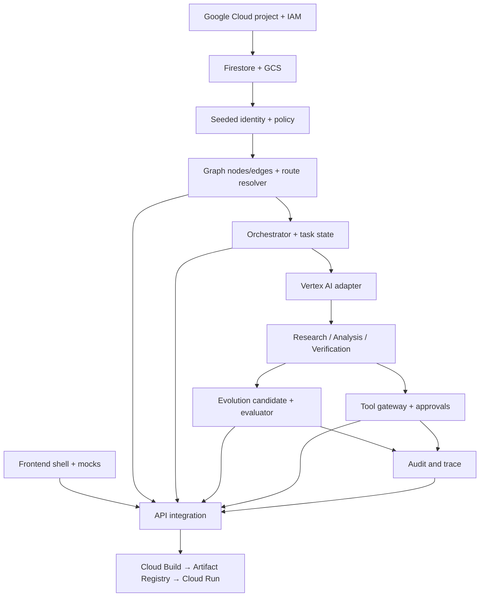

# 14 — Build Order, Dependency Graph and Cutline

## Critical path

## Feature priority

P0 (must work): GCP deployment, auth, RBAC/ABAC, graph route resolution, route identity difference, Vertex adapter, three bounded agents, evolution evaluation + admin approval, tool gateway, audit trace.

P1 (should work): graph canvas polish, prompt diff, route ranking explanation, GCS evidence upload, rollback UI, basic Cloud Monitoring dashboard.

P2 (cut first): animated graph, advanced analytics, multi-task dashboard, user-configurable graph editor, extra agents, extra model provider, full text search, elaborate onboarding.

## Definition of a true end-to-end pass

A single task must traverse the backend state machine, resolve the graph route for the authenticated principal, read only authorised synthetic data, invoke Gemini via Vertex AI, delegate to three agents, verify output, require approval for the simulated action, write audit events and display the actual results in the frontend.
