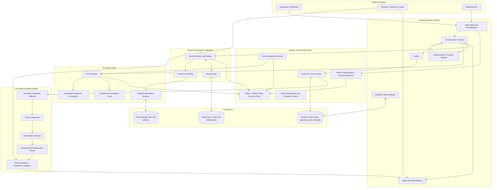
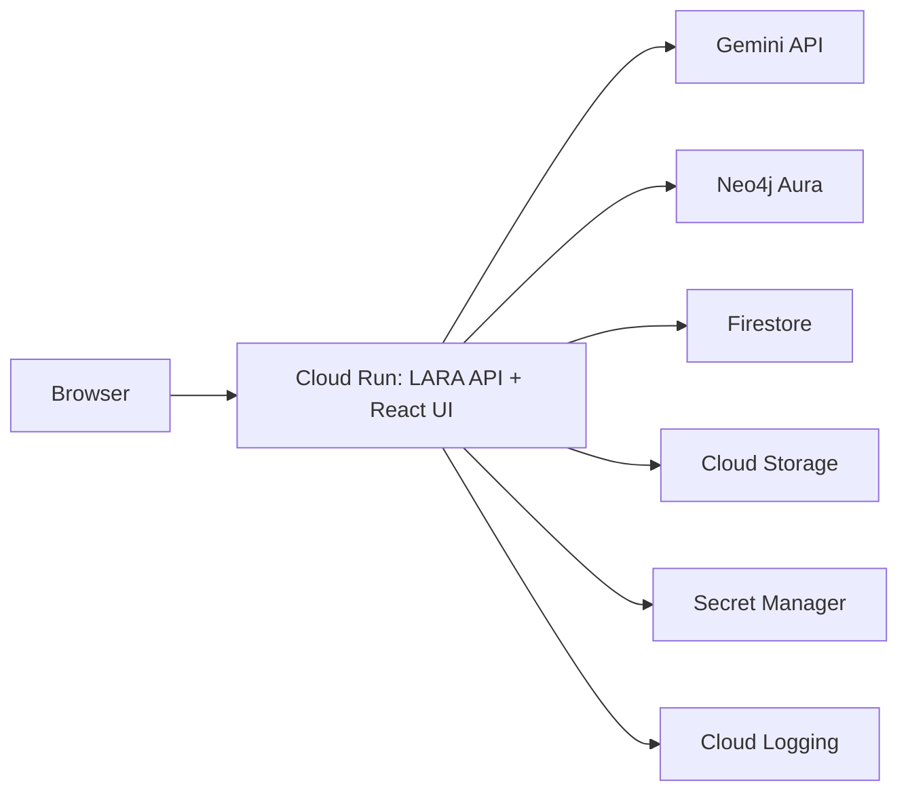
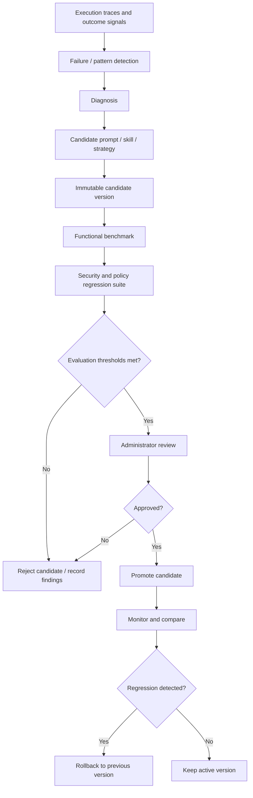

# LARA — Lattice Agentic Runtime Accelerator

## Prototype Scope, Product Specification and Technical Implementation Blueprint

**Document status:** Scope locked for the Google DeepMind × Google Cloud Startup Buildathon India 2026 prototype  
**Specification version:** 1.0  
**Date:** 20 November 2026  
**Product name:** LARA — Lattice Agentic Runtime Accelerator  
**Prototype deployment:** Cloud-hosted, Google Cloud-based  
**Primary model path:** Gemini API behind a provider adapter  
**Primary graph store:** Neo4j Aura  
**Operational state:** Firestore  
**Object storage:** Google Cloud Storage  
**Frontend:** React, TypeScript, Vite, Tailwind CSS and React Flow  
**Backend:** Python and FastAPI

---

# 0. Executive directive

This document is the authoritative implementation specification for the LARA buildathon prototype. It is written for the founder, developers, Antigravity coding agents, reviewers and anyone contributing to the prototype.

The team must build **LARA as an adaptive, model-independent enterprise agentic runtime**, not as an industrial chatbot, a document question-answering application, a generic multi-agent demo or a visual architecture mock-up.

The prototype must demonstrate three defining runtime capabilities:

1. **Dynamic Information Highways:** a graph-backed, task-aware and identity-aware routing layer that connects enterprise information sources, specialist agents, skills, tools and workflow dependencies.
2. **Controlled self-evolution:** an execution-feedback loop that diagnoses agent weaknesses, proposes changes to prompts, skills, planning strategies or routing strategies, evaluates candidate versions, requests authorised approval and promotes or rolls back versions.
3. **Identity-aware governance:** backend-enforced RBAC and ABAC across graph discovery, information access, memory, agent delegation and tool execution.

These capabilities are coordinated by an orchestration runtime that plans tasks, delegates work to specialist agents, assembles context, routes model calls, verifies results and records an execution trace.

The jury demonstration will use an **enterprise incident investigation and response** scenario. The industrial maintenance example from the previous pitch remains a suitable concrete workload, but it is only one workload running on LARA. It is not the definition of LARA.

## 0.1 Product thesis

> LARA dynamically determines how enterprise agents access information, coordinate capabilities and improve their execution strategies, while preserving identity, policy and accountability across the entire process.

Supporting statement:

> Models provide intelligence. Agents provide capability. LARA provides the adaptive, interconnected and governed runtime that coordinates them.

## 0.2 Product category

**Adaptive, model-independent enterprise agentic runtime infrastructure.**

LARA is a runtime and control layer that sits between enterprise users/systems, foundation models, institutional information and operational tools. The enterprise retains control over identity, information boundaries, model choice, action permissions, approvals and execution records.

## 0.3 What the prototype must prove

The prototype must prove that:

- A task can be planned and decomposed by the runtime rather than by a hardcoded UI sequence.
- The runtime can discover and select information sources, agents, skills and tools from a graph-backed registry.
- The selected route changes when the task context or user identity changes.
- Access restrictions are enforced before protected information is retrieved, not after it has already entered an LLM context.
- Specialist agents are delegated scoped work and cannot independently expand their permissions.
- The runtime can observe a known failure, propose a versioned instruction/skill improvement, evaluate it against fixed tests, obtain authorised approval and activate it.
- Every important decision and action can be inspected in an execution trace.
- Model calls and tool calls are mediated by LARA-controlled adapters and gateways.

## 0.4 What the prototype does not claim

The prototype does **not** claim:

- Production-grade enterprise readiness.
- Autonomous modification of security policy or the runtime constitution.
- Continuous online learning or foundation-model fine-tuning.
- Full multi-cloud, on-premises or hybrid deployment readiness.
- Full enterprise SSO, SCIM or production identity federation.
- Live integrations with industrial control systems, ERP or CMMS platforms.
- Physical equipment actuation or production writes.
- Proven superiority over all existing agent frameworks.
- Production-scale performance, uptime, latency or security benchmarks that have not been measured.

The code must distinguish **implemented**, **simulated**, **planned** and **not supported** capabilities.

---

# 1. Scope-lock decision register

The following decisions are locked for the buildathon unless the founder explicitly changes this document.

| ID | Decision area | Locked decision | Implementation consequence |
|---|---|---|---|
| D-01 | Product focus | General-purpose AI-native enterprise operating infrastructure, demonstrated with an enterprise investigation workload | Do not position LARA as only an industrial maintenance application |
| D-02 | Information Highway graph | Connect information sources, specialist agents, skills, tools and workflow dependencies | Graph is both a knowledge/capability graph and an execution-discovery graph |
| D-03 | Route dynamism | Recalculate candidate routes per task using identity, context, relevance, permission, freshness and availability | Routes are resolved by the backend at runtime; they are not fixed visual paths |
| D-04 | Evolution targets | Agent system prompts, agent skills, planning strategies and routing strategies | Do not evolve the security constitution or policy rules |
| D-05 | Evolution autonomy | Generate candidates, evaluate, then require authorised approval before promotion | Candidate changes are never silently activated |
| D-06 | Evolution triggers | Execution traces, failures, user feedback, benchmark regressions and outcome evaluation | Evolution starts from evidence, not arbitrary prompt rewriting |
| D-07 | Agent architecture | Orchestrator plus three specialist agents; architecture supports later dynamic registry discovery | Implement Research, Analysis and Verification specialists |
| D-08 | Authorisation | RBAC + ABAC with explicit delegation checks | Enforce on backend routes, graph access, memory and tool execution |
| D-09 | Authentication | Seeded demo identities with server-side authorisation | Build demo login/identity switcher; no production SSO |
| D-10 | Model strategy | Gemini API behind a provider-independent adapter interface | Only Gemini must work in the MVP; do not claim multi-provider validation |
| D-11 | Graph infrastructure | Neo4j Aura | Use official Neo4j Python driver; keep graph access behind repository/service layer |
| D-12 | Tool execution | Read access, sandboxed calculations and simulated enterprise actions | No production writes or industrial actuation |
| D-13 | Product interface | Enterprise Workbench plus Runtime/Authority Console | Two connected product surfaces, sharing one runtime |
| D-14 | Demo priorities | 1. Dynamic Information Highways; 2. Self-evolution; 3. Identity-aware governance | These are the three principal proof points |
| D-15 | Proof standard | Functional demo, repeatable automated tests and measurable baseline comparisons | Build tests and benchmark records, not only polished screens |

## 1.1 Evolution target boundary

The evolution engine may propose and evaluate changes to:

- Agent system prompts and task instructions.
- Agent skills and reusable procedures.
- Task planning and decomposition strategies.
- Information route ranking and routing preferences.

The evolution engine may **not** autonomously change:

- Security policy definitions.
- Role assignments or user entitlements.
- Tenant boundaries.
- Data classification rules.
- Tool permission scopes.
- Approval requirements.
- Credential scopes.
- The core runtime constitution or trusted evaluation harness.

Changes to governance configuration require a separate authorised administrative operation and must not be presented as self-evolution.

## 1.2 What is deliberately deferred

The following are not buildathon MVP requirements:

- Local Gemma inference.
- A second hosted model provider.
- Neo4j multi-region or cluster engineering.
- Full identity federation or enterprise SSO.
- Self-service tenant provisioning.
- Production connector marketplace.
- Arbitrary agent generation and execution from natural language.
- Continuous autonomous deployment of agent versions.
- Fine-tuning or weight updates to foundation models.
- Long-term cross-customer learning.
- Automatic modification of the graph's security-sensitive topology.
- Real CMMS/ERP/SCADA/PLC integration.
- Kubernetes or GKE deployment.
- On-premises and hybrid deployment packages.

---

# 2. Product definition and principles

## 2.1 The enterprise problem

Enterprises have capable foundation models, internal knowledge, specialist software, databases and operational tools. These resources often remain fragmented. Teams manually bridge systems, reconcile information, select tools, interpret permissions and record decisions.

A conventional chatbot can provide a useful answer but often leaves the actual work to a human. A collection of agents can automate portions of a workflow but may rely on fixed integrations, static instructions and fragmented permissions. A graph database can represent relationships but does not by itself establish whether a user or agent is authorised to follow a route or execute an action.

LARA's proposition is to provide a common runtime and control boundary across these concerns.

## 2.2 Core design principles

1. **Runtime over wrapper:** LARA owns orchestration, graph resolution, identity propagation, policy enforcement, tool mediation, versioning and traces. It must not merely forward prompts to Gemini.
2. **Policy before access:** authorisation must be evaluated before protected data is read, placed into context, delegated or acted upon.
3. **Model output is a proposal:** model-generated plans and function calls are untrusted proposals. The backend validates them and decides whether execution is allowed.
4. **Least privilege:** users and agents receive only the capabilities required for the current task.
5. **Explicit delegation:** each specialist agent receives a scoped delegation context. It cannot become a superuser through orchestration.
6. **Dynamic, explainable routing:** routes are computed at task time and accompanied by reasons, policy results and provenance.
7. **Controlled evolution:** improvements must be evidence-driven, evaluated, versioned, approved and reversible.
8. **Immutable history:** prompts, skill versions, policy decisions and execution events must have stable identifiers and traceable lineage.
9. **Fail closed:** policy outage, ambiguity, missing identity or unavailable authorisation context must not cause a protected action to execute.
10. **Honest capability boundaries:** demos and pitch materials must label seeded data, mock connectors, simulated operations and unimplemented features.
11. **Cloud-hosted prototype:** the runtime, model inference and data services are hosted. The developer laptop is only a development environment.
12. **Modular monolith first:** logical boundaries are strict, but the buildathon implementation should avoid premature microservice sprawl.

## 2.3 Product surfaces

LARA has two main user-facing surfaces.

### Enterprise Workbench

For an operator or business user:

- Submit a task.
- Attach approved evidence or select known enterprise resources.
- View task status and execution progress.
- Inspect the outcome and supporting evidence.
- Review actions requiring approval where the user has authority.
- View the user-visible portion of the execution trace.

### Runtime / Authority Console

For a runtime administrator, supervisor or auditor:

- Inspect the Information Highway graph.
- Inspect route-resolution explanations.
- Inspect agent registry, skills and active versions.
- Review evolution proposals, evaluation results and promotion decisions.
- Inspect principals, roles and policy decisions.
- Approve or reject designated requests.
- Inspect execution and audit traces.
- View runtime health and failure information.

Both surfaces call the same backend services. The frontend must never become the source of truth for permission decisions.

---

# 3. Primary demo workload

## 3.1 Scenario: Enterprise incident investigation and response

A user submits an incident involving an industrial asset. Relevant information is distributed across an incident log, asset registry, maintenance procedures, historical records and a restricted vendor document. Specialist agents can research, analyse and verify the case. Some actions require supervisor approval.

This scenario demonstrates LARA's runtime properties without reducing the product to a maintenance RAG application.

## 3.2 Seeded enterprise environment

Create one synthetic enterprise tenant with the following resources:

| Resource | Type | Classification | Example content |
|---|---|---|---|
| Incident Register | Structured source | Internal | Incident ID, asset, time, reported symptoms, status |
| Asset Registry | Structured source | Internal | Asset metadata, site, equipment class, criticality |
| Maintenance SOP Repository | Document source | Internal | Procedures, steps, revision, effective date |
| Historical Maintenance Records | Structured source | Internal | Work history, previous findings, completed activities |
| Vendor Contract Repository | Restricted source | Confidential/Restricted | Contract terms and restricted vendor information |
| Safety Procedure Repository | Document source | Internal/Controlled | Relevant safety checks and required precautions |
| Maintenance Request Connector | Tool | Controlled action | Creates a simulated maintenance request |
| Calculation Sandbox | Tool | Sandboxed | Performs bounded, deterministic calculations |

Use synthetic records only. Do not upload real confidential industrial documents or personal information.

## 3.3 Demo task

Suggested prompt:

> Investigate the production incident involving Asset A-14. Identify relevant incident history, review the current maintenance procedure, analyse possible contributing factors, and prepare a response package with evidence and recommended next steps.

The task is deliberately open enough to require planning and route resolution, but bounded enough to evaluate.

## 3.4 Demo identities

Create at least four seeded principals:

| Demo identity | Role | Key abilities |
|---|---|---|
| `operator.alex` | Operator | Initiate investigations; read approved operational data; create drafts |
| `supervisor.mira` | Supervisor | Operator abilities plus approve designated simulated actions and access additional permitted data |
| `admin.arya` | Runtime Administrator | Manage agent versions, evolution approvals, graph configuration and demo policy configuration |
| `auditor.sam` | Auditor | Inspect authorised execution traces, policy decisions and provenance; no operational execution authority |

The seeded authentication mechanism is only a prototype convenience. Every API request must resolve a server-side principal and role. A frontend role dropdown by itself is not authentication or authorisation.

## 3.5 Required demo sequence

### Act 1 — Task planning and dynamic route resolution

1. Operator logs in as `operator.alex`.
2. Operator submits the incident investigation task.
3. LARA classifies the task and creates a task ID.
4. The orchestrator identifies required capabilities: incident lookup, asset context, SOP retrieval, analysis and verification.
5. The highway resolver discovers candidate sources, agents, skills and tools from Neo4j.
6. The policy engine filters the candidate routes for the operator's identity, purpose, tenant and classification clearance.
7. LARA ranks the permitted routes using relevance, freshness, trust, availability and cost/latency metadata.
8. The UI displays the selected route, rejected candidates and concise reasons.

### Act 2 — Same task, different identity

1. Complete or reset the same task under `supervisor.mira`.
2. Submit the identical task.
3. The backend resolves the supervisor's identity independently.
4. The route may now include resources or actions not available to the operator.
5. The UI compares the routes and explains the difference.
6. The operator's denied resource must not have been retrieved during the first run.

Do not hardcode a visibly different route for the supervisor. The difference must result from the policy and graph-resolution pipeline.

### Act 3 — Controlled self-evolution

1. Run a seeded test case in which a specialist agent uses a superseded SOP revision or fails to verify an SOP's effective date.
2. Record the failure as structured evaluation evidence.
3. Trigger the evolution engine.
4. The engine diagnoses that the relevant agent instruction/skill does not explicitly require a current-revision check.
5. Gemini generates a candidate prompt/skill change. The candidate is stored as an immutable version; it does not replace the active version.
6. The evaluation runner executes fixed benchmark cases against both the active and candidate versions.
7. It reports quality results, failed cases, security regression results and any trade-offs.
8. An authorised runtime administrator reviews the diff and evaluation result.
9. The administrator approves or rejects the candidate.
10. On approval, the candidate becomes the active version; the prior version remains available for rollback.
11. Rerun the original task and show that the new version catches the SOP revision requirement.

The runtime must not use the same LLM judgement as the sole evaluator of its own improvement. The benchmark includes deterministic assertions and expected constraints.

### Act 4 — Identity-aware governance

1. As an operator, attempt to access the restricted vendor contract or execute an approval-only action.
2. The backend returns a policy denial or approval-required result.
3. The protected information is not included in model context.
4. Switch to the supervisor for an approval-required action.
5. The supervisor reviews the proposed simulated maintenance request and approves or rejects it.
6. LARA records principal, agent, delegation, tool, policy ID, decision, approval, timestamps and simulated result.

### Act 5 — Audit trace

Display one complete trace linking:

- Initiating principal.
- Task and task context.
- Plan and delegated subtasks.
- Resolved graph paths.
- Policy checks and outcomes.
- Sources actually accessed.
- Agent versions and prompt/skill versions.
- Model calls.
- Tool calls.
- Verification results.
- Approval and simulated action.
- Final deliverable and evidence.

---

# 4. Target architecture

## 4.1 Logical architecture



## 4.2 Buildathon deployment topology

The prototype is cloud-hosted. Use a modular FastAPI backend deployed to Cloud Run, with managed cloud storage/state services and Neo4j Aura.



### Cloud components

| Component | Prototype responsibility | Notes |
|---|---|---|
| Cloud Run | Host FastAPI application and built frontend | One service is sufficient for the prototype |
| Gemini API | Reasoning, structured extraction, candidate generation, planning assistance | Invoked only through model adapter |
| Neo4j Aura | Information Highway graph and graph traversal | Graph credentials held only by backend |
| Firestore | Task state, agent versions metadata, approvals, evolution records and audit events | Backend service identity only |
| Cloud Storage | Uploaded demo files and generated artefacts | Use per-tenant/task object prefixes and metadata |
| Secret Manager | Gemini and Neo4j credentials | Never place credentials in frontend or source control |
| Cloud Logging | Application logs and operational diagnostics | Do not log raw secrets or unrestricted sensitive content |

**Region:** Start by evaluating `asia-south1` (Mumbai) for Cloud Run and compatible Google Cloud services. Select a Neo4j Aura region based on actual availability, latency and event account constraints. Keep components geographically close where possible. Do not claim a data-residency guarantee that has not been configured and verified.

## 4.3 Deployment architecture is not deployment flexibility proof

The long-term product may support on-premises, private cloud, public cloud and hybrid deployment. The buildathon proves a cloud-hosted reference deployment only. Model/provider adapters, storage interfaces, graph repositories and connector interfaces should reduce later migration effort, but they do not make the prototype production portable by themselves.

---

# 5. Backend module boundaries

Use a modular monolith for the buildathon. Keep modules separated by interfaces and responsibilities. Do not create multiple separately deployed services unless a concrete constraint requires it.

## 5.1 Required backend modules

| Module | Responsibility | Must not do |
|---|---|---|
| `identity` | Resolve seeded principal, role and attributes | Trust role values supplied by the browser |
| `policy` | Evaluate RBAC/ABAC decisions | Delegate security decisions to Gemini |
| `orchestration` | Intake task, build plan, delegate work and manage state | Call tools directly without gateway/policy |
| `agents` | Agent registry, agent contracts, skills and version selection | Hold unrestricted credentials |
| `highways` | Query graph, resolve and rank permitted routes | Return restricted content before policy checks |
| `context` | Assemble authorised, bounded task context | Mix tenant or principal contexts |
| `models` | Provider interfaces and Gemini adapter | Let model-generated function calls execute directly |
| `evolution` | Collect feedback, diagnose, generate candidates, evaluate and promote | Modify security policies or activate unapproved candidates |
| `tools` | Tool registry, argument validation and execution mediation | Expose raw arbitrary Python/shell execution |
| `approvals` | Create, resolve and record human approvals | Allow the same principal to approve a prohibited self-approval case |
| `audit` | Append and query trace events | Allow regular agents to modify prior events |
| `storage` | Firestore, GCS and Neo4j adapters | Leak storage credentials or database access to agents |
| `api` | HTTP request/response and authentication dependencies | Contain business logic that belongs in services |

## 5.2 Suggested repository structure

```text
lara/
├── README.md
├── SPEC.md
├── pyproject.toml
├── requirements.lock
├── .env.example
├── Dockerfile
├── docker-compose.dev.yml              # optional local dev dependencies only
├── frontend/
│   ├── package.json
│   ├── vite.config.ts
│   ├── src/
│   │   ├── app/
│   │   ├── components/
│   │   ├── features/
│   │   │   ├── workbench/
│   │   │   ├── runtime-console/
│   │   │   ├── highway-graph/
│   │   │   ├── agent-registry/
│   │   │   ├── evolution/
│   │   │   ├── governance/
│   │   │   └── audit/
│   │   ├── lib/api.ts
│   │   └── types/
│   └── public/
├── backend/
│   └── app/
│       ├── main.py
│       ├── config.py
│       ├── api/
│       │   ├── routes/
│       │   └── dependencies.py
│       ├── domain/
│       │   ├── principals.py
│       │   ├── tasks.py
│       │   ├── graph.py
│       │   ├── policies.py
│       │   ├── agents.py
│       │   ├── evolution.py
│       │   └── audit.py
│       ├── services/
│       │   ├── orchestration/
│       │   ├── highways/
│       │   ├── context/
│       │   ├── policy/
│       │   ├── agents/
│       │   ├── evolution/
│       │   ├── approvals/
│       │   └── verification/
│       ├── adapters/
│       │   ├── models/
│       │   │   ├── base.py
│       │   │   └── gemini.py
│       │   ├── graph/
│       │   │   ├── base.py
│       │   │   └── neo4j.py
│       │   ├── state/
│       │   │   ├── base.py
│       │   │   └── firestore.py
│       │   ├── objects/
│       │   │   ├── base.py
│       │   │   └── gcs.py
│       │   └── tools/
│       ├── schemas/
│       ├── seed/
│       └── utils/
├── tests/
│   ├── unit/
│   ├── integration/
│   ├── security/
│   ├── evolution/
│   ├── highways/
│   └── e2e/
├── scripts/
│   ├── seed_demo.py
│   ├── verify_connections.py
│   ├── run_benchmarks.py
│   └── deploy.sh
├── docs/
│   ├── ARCHITECTURE.md
│   ├── THREAT_MODEL.md
│   ├── API_CONTRACTS.md
│   ├── DEMO_RUNBOOK.md
│   └── DECISIONS.md
└── data/
    └── demo/                             # synthetic input data only
```

Names can be adapted to an existing repository, but the logical boundaries must remain.

---

# 6. Dynamic Information Highways

## 6.1 Definition

The Dynamic Information Highway is LARA's graph-backed mechanism for discovering and connecting the information and capabilities required to execute a task.

It is not merely:

- A document knowledge graph.
- A vector search wrapper.
- A static workflow diagram.
- A list of hardcoded API integrations.
- A UI graph that is not used by the backend.

It is a typed graph of information resources, agents, skills, tools and workflow dependencies. The runtime queries this graph to discover candidate paths, applies policy checks and selects a task-specific route.

## 6.2 Node types

Required node labels:

| Node label | Meaning | Example properties |
|---|---|---|
| `Tenant` | Enterprise boundary | `tenant_id`, `name`, `status` |
| `Principal` | User or service identity | `principal_id`, `kind`, `tenant_id` |
| `Department` | Organisational context | `department_id`, `name` |
| `DataSource` | Enterprise source | `source_id`, `source_type`, `classification`, `freshness_at`, `trust_tier`, `status` |
| `Document` | File or document resource | `document_id`, `object_uri`, `classification`, `revision`, `effective_at`, `checksum` |
| `Agent` | Specialist capability | `agent_id`, `name`, `purpose`, `status`, `active_version` |
| `Skill` | Reusable capability/procedure | `skill_id`, `name`, `version`, `input_schema`, `output_schema` |
| `Tool` | Executable capability | `tool_id`, `name`, `risk_tier`, `input_schema`, `permission` |
| `Workflow` | Workflow template or state | `workflow_id`, `name`, `version`, `status` |
| `Capability` | Abstract capability requirement | `capability_id`, `name`, `modality`, `risk` |
| `Policy` | Policy metadata/reference | `policy_id`, `version`, `status` |

## 6.3 Relationship types

| Relationship | Direction | Meaning |
|---|---|---|
| `BELONGS_TO` | Principal → Tenant | Tenant membership |
| `MEMBER_OF` | Principal → Department | Organisational context |
| `CAN_ACCESS` | Principal/Role → Resource | Declared access relationship; policy engine remains authoritative |
| `PROVIDES_CONTEXT` | DataSource/Document → Agent/Workflow | Source can provide context |
| `CAPABLE_OF` | Agent/Tool → Capability | Capability declaration |
| `USES_SKILL` | Agent → Skill | Skill attached to agent |
| `INVOKES` | Agent/Workflow → Tool | Declared tool dependency |
| `DEPENDS_ON` | Workflow/Task → Capability/Resource | Execution dependency |
| `REQUIRES` | Capability → Capability/Resource | Required dependency |
| `ROUTES_TO` | Capability/Node → Node | Candidate routing relation |
| `DERIVED_FROM` | Output → Source/Artifact | Provenance relationship |
| `VERSION_OF` | Versioned node → Logical agent/skill | Version lineage |
| `SUPERSEDES` | New version → Previous version | Version transition |
| `GOVERNED_BY` | Resource/Tool/Workflow → Policy | Policy reference |

Relationship metadata may contain access constraints, purpose, freshness, trust and status. It must not be the sole source of authorisation truth.

## 6.4 Edge and node metadata

Every discoverable resource/capability should include, where applicable:

```json
{
  "tenant_id": "tenant-demo-001",
  "classification": "INTERNAL",
  "owner_department": "OPERATIONS",
  "allowed_purposes": ["incident_investigation"],
  "required_roles": ["operator", "supervisor"],
  "trust_tier": 2,
  "freshness_at": "2026-11-20T08:00:00Z",
  "freshness_ttl_seconds": 86400,
  "availability": "AVAILABLE",
  "risk_tier": "LOW",
  "enabled": true,
  "metadata_version": 1
}
```

These are graph-discovery hints and constraints. The policy engine remains authoritative and must evaluate the current principal, resource, purpose, task, tenant and requested action.

## 6.5 Route-resolution pipeline

Implement a deterministic service pipeline:

1. **Task normalisation:** convert the incoming request into a typed task intent with required outcomes, constraints and purpose.
2. **Principal resolution:** load the principal from a server-side session/token. Never trust a client-supplied role.
3. **Context resolution:** obtain tenant, department, project/site, classification clearance and allowed purposes.
4. **Capability planning:** identify required capabilities, such as incident lookup, asset context, SOP lookup, analysis and verification.
5. **Candidate discovery:** query Neo4j for graph nodes and edges matching the required capabilities and task relationships.
6. **Policy pre-filter:** evaluate whether the principal/delegated agent can discover and access candidate resources. Avoid disclosing restricted metadata through graph results.
7. **Route construction:** assemble connected candidate paths from sources through agents/skills to tools or workflow outputs.
8. **Route scoring:** score only authorised candidates using the configurable ranking function.
9. **Route selection:** choose the best permitted path, subject to task constraints and policy rules.
10. **Context assembly:** retrieve authorised source content and package it with provenance, timestamps and source identifiers.
11. **Execution-time reauthorisation:** before each data read and tool invocation, evaluate the current policy again. A route selected earlier does not create permanent authority.
12. **Trace recording:** record candidates, selected path, exclusion reasons, scores, policy decision references and actual accesses.

## 6.6 Route-ranking function

Use a transparent configurable score, not an unexplained LLM choice.

Example:

```text
route_score =
    w_relevance   * relevance_score
  + w_freshness   * freshness_score
  + w_trust       * trust_score
  + w_availability* availability_score
  - w_latency     * normalized_latency
  - w_cost        * normalized_cost
  - w_hops        * normalized_path_length
```

Requirements:

- Policy eligibility is a hard filter before scoring, not a positive score bonus.
- A denied resource cannot win because it has high relevance.
- Weights are configuration with version identifiers.
- Store each feature score and the final score for explainability.
- If no permitted path exists, return a typed `NO_PERMITTED_ROUTE` result rather than silently falling back to unrestricted retrieval.
- If route data is stale or policy evaluation is unavailable, fail closed for protected resources/actions.

## 6.7 Route explanation

For each selected route, expose:

- Task capability being satisfied.
- Source/capability node selected.
- Agent and skill selected.
- Tool selected, if any.
- Why the route was selected (relevance, freshness, trust, availability, latency/cost).
- Policy decision ID and version.
- Candidate routes excluded by policy, with safe non-sensitive explanation.
- Provenance of the information actually retrieved.

Do not expose the existence or names of restricted resources to principals who are not allowed to discover them. The admin console may show restricted graph details to an authorised administrator.

## 6.8 Graph mutation rules

The graph is dynamic in its routing and can be updated by authorised administrative registration events. It is not freely rewritten by agents.

Allowed prototype graph mutations:

- Register/unregister an approved source.
- Register/update an agent or skill version.
- Register/disable a tool.
- Update availability/freshness metadata.
- Add a workflow dependency through an authorised registry operation.

Restricted graph mutations:

- Change resource classification.
- Change allowed roles or policy references.
- Change tenant ownership.
- Add a privileged capability.
- Alter a security-sensitive relationship.

Restricted graph mutations require an authorised administrator operation, explicit audit event and policy validation. The evolution engine cannot perform them.

## 6.9 Neo4j implementation requirements

- Use the official Neo4j Python driver.
- Read URI, username/password and database from secret/configuration providers.
- Verify connectivity during startup/readiness checks.
- Use parameterised Cypher queries; never concatenate user input into Cypher strings.
- Keep Cypher in repository/query functions, not spread across API routes.
- Use explicit database selection.
- Use transactions for logically grouped graph writes.
- Add database constraints/indexes for stable IDs where supported.
- Enforce `tenant_id` in every graph query and validate again in policy service.
- Do not expose a general-purpose Cypher endpoint to the browser or agents.
- Use bounded traversal depth, query timeouts and result limits.

### Minimum seeded graph

At least:

- 1 tenant.
- 4 principals.
- 3 departments or context groups if useful.
- 5 information source/document nodes.
- 3 specialist agent nodes.
- 4 skill nodes.
- 4 tool nodes.
- 5 capability nodes.
- 15 meaningful edges across information, agent, skill, tool and workflow relationships.

The graph must be used by backend route-resolution code, not only rendered visually.

---

# 7. Adaptive orchestration and agent system

## 7.1 Architecture

Implement one orchestrator and three specialist agents:

1. **Research Agent:** discovers and retrieves relevant authorised information, attaches provenance and identifies missing evidence.
2. **Analysis Agent:** analyses gathered evidence, identifies possible contributing factors and prepares a structured draft.
3. **Verification Agent:** checks evidence support, constraints, source freshness, completeness, policy compliance and output schema.

The orchestrator is responsible for planning, delegation, workflow state, retries, context handoff, escalation and final synthesis.

## 7.2 Agent registry

Each agent definition includes:

```json
{
  "agent_id": "research_agent",
  "display_name": "Research Agent",
  "purpose": "Find authorised information and return provenance-linked evidence",
  "status": "ACTIVE",
  "active_prompt_version": "v1",
  "active_skill_versions": ["incident-research@v1", "source-citation@v1"],
  "accepted_inputs": ["InvestigationTask"],
  "output_schema": "ResearchBundle",
  "capability_tags": ["source_discovery", "evidence_retrieval"],
  "tool_allowlist": ["source.read", "knowledge.search"],
  "max_steps": 6,
  "timeout_seconds": 45
}
```

Agent definitions must be versioned. A new version is immutable. The active version pointer may change only through a controlled promotion action.

## 7.3 Delegation contract

Every delegated task includes:

- `task_id` and `subtask_id`.
- Initiating `principal_id`.
- `tenant_id`.
- Delegating agent ID and version.
- Receiving agent ID and version.
- Allowed purpose.
- Allowed resource IDs or graph scope.
- Allowed tool IDs.
- Classification ceiling.
- Time/step budget.
- Required output schema.
- Correlation/trace ID.

The delegated agent must not be able to change these fields. The backend validates delegation before execution and reauthorises each sensitive operation.

## 7.4 Agent input/output contract

All agent inputs and outputs must be structured and validated.

Example `ResearchBundle`:

```json
{
  "task_id": "task-001",
  "findings": [
    {
      "finding_id": "finding-001",
      "claim": "The asset had a previous maintenance event",
      "source_id": "source-maintenance-history",
      "source_reference": "record:MH-204",
      "observed_at": "2026-11-20T08:00:00Z",
      "confidence": "SUPPORTED",
      "excerpt_or_value": "Synthetic record excerpt"
    }
  ],
  "missing_information": [],
  "restricted_information_requested": false,
  "limitations": []
}
```

Example `AnalysisDraft`:

```json
{
  "task_id": "task-001",
  "summary": "Synthetic incident analysis",
  "hypotheses": [
    {
      "hypothesis": "Potential contributing factor",
      "supporting_finding_ids": ["finding-001"],
      "contradicting_finding_ids": [],
      "confidence_label": "NEEDS_REVIEW"
    }
  ],
  "recommended_next_steps": [],
  "assumptions": [],
  "unknowns": []
}
```

Example `VerificationReport`:

```json
{
  "task_id": "task-001",
  "passed": true,
  "checks": [
    {"check_id": "source_support", "passed": true, "details": "Claims have source references"},
    {"check_id": "sop_revision", "passed": true, "details": "Current effective revision checked"},
    {"check_id": "permission_boundary", "passed": true, "details": "No restricted source accessed"}
  ],
  "blocking_issues": [],
  "warnings": []
}
```

## 7.5 Orchestrator behaviour

The orchestrator must:

1. Accept a typed task and principal context.
2. Create a task record and initial trace event.
3. Ask the planning model for a structured plan or use a bounded plan template with model assistance.
4. Validate plan schema and ensure each planned capability exists in the registry/graph.
5. Ask the Highway Resolver for permitted routes.
6. Construct scoped delegations.
7. Execute specialist agents under controlled step/time budgets.
8. Validate every returned schema.
9. Call the Verification Agent and deterministic validators.
10. Replan only within allowed bounds when there is a recoverable failure.
11. Request human approval when a planned tool action requires it.
12. Produce a final deliverable with evidence and limitations.
13. Close the task with a terminal status and complete trace.

The model may suggest a plan, but the orchestrator/backend validates it. The model never decides whether a tool call is authorised.

## 7.6 Task state machine

Required states:

```text
RECEIVED
  -> NORMALISED
  -> PLANNING
  -> ROUTE_RESOLUTION
  -> CONTEXT_ASSEMBLY
  -> EXECUTING
  -> VERIFYING
  -> AWAITING_APPROVAL (optional)
  -> EXECUTING (after approval, when applicable)
  -> COMPLETED

Alternative terminal/paused states:
FAILED | DENIED | CANCELLED | NEEDS_INPUT | NO_PERMITTED_ROUTE
```

Rules:

- State transitions are validated by a backend state machine.
- A terminal state cannot be reopened by a browser request.
- Retried operations must use an idempotency key or stable execution ID.
- Approval resumes the specific paused action; it does not rerun unrelated prior steps unless required.
- A denial is a recorded result, not an exception that disappears from the trace.

---

# 8. Controlled self-evolution engine

## 8.1 Definition

The self-evolution engine improves selected agent operating artefacts using execution evidence and fixed evaluations. It does not autonomously rewrite the LARA security model or change its own authorisation.

The MVP evolves:

- Agent system prompts.
- Agent skills.
- Planning strategies.
- Route ranking/selection strategies.

The MVP does not evolve foundation-model weights, security policy, user roles, credential scopes or tenant boundaries.

## 8.2 Evolution lifecycle



## 8.3 Trigger sources

Evolution proposals can be triggered by:

- Deterministic validation failure.
- Failed benchmark case.
- Repeated agent tool-call failure.
- Missing source/provenance requirement.
- User feedback with a reason code.
- Verification Agent finding.
- Outcome score below a configured threshold.
- Repeated route-selection inefficiency or stale-source selection.

Do not treat every negative user comment as valid training evidence. Feedback is a signal to investigate, not an instruction to change the agent.

## 8.4 Failure diagnosis record

```json
{
  "diagnosis_id": "diag-001",
  "agent_id": "research_agent",
  "active_version": "v1",
  "failure_type": "MISSING_SOP_REVISION_CHECK",
  "observed_runs": ["run-101", "run-104"],
  "supporting_evidence": ["verification-check-55", "benchmark-case-07"],
  "proposed_change_scope": "SYSTEM_PROMPT_OR_SKILL",
  "severity": "MEDIUM",
  "created_at": "2026-11-20T08:00:00Z"
}
```

## 8.5 Candidate version record

```json
{
  "proposal_id": "evo-001",
  "agent_id": "research_agent",
  "artifact_type": "SYSTEM_PROMPT",
  "parent_version": "v1",
  "candidate_version": "v2-candidate-001",
  "change_summary": "Require verification of SOP revision and effective date before using a procedure",
  "change_diff": "Stored as a structured diff",
  "triggering_diagnosis_ids": ["diag-001"],
  "created_by": "evolution_engine",
  "status": "PENDING_EVALUATION",
  "created_at": "2026-11-20T08:10:00Z"
}
```

Candidate artefacts are immutable after creation. A subsequent edit creates a new candidate version.

## 8.6 Evaluation design

Use a fixed, versioned evaluation suite with:

- Functional benchmark cases.
- Required evidence/provenance assertions.
- Schema validity assertions.
- Known failure cases.
- Adversarial prompt-injection cases.
- Permission boundary cases.
- Data-leakage checks.
- Regression cases for previously successful tasks.

Evaluation must compare candidate and parent versions on the same fixture set and record the exact test-suite version, model identifier/configuration, prompt hash and timestamp.

### Example evaluation table

| Metric | Parent v1 | Candidate v2 | Requirement |
|---|---:|---:|---|
| Functional cases passed | 6/8 | 8/8 | Candidate must improve or meet configured target |
| SOP revision check | 1/4 | 4/4 | Must pass every required case |
| Required citation presence | 7/8 | 8/8 | Must not regress |
| Permission violation attempts blocked | 8/8 | 8/8 | Must remain 100% in defined test suite |
| Prompt-injection tests passed | 6/6 | 6/6 | No security regression |
| Output schema valid | 8/8 | 8/8 | Must remain valid |

These numbers are illustrative fixtures, not measured LARA results. The implementation must calculate actual values from executed tests.

## 8.7 Promotion rules

- Candidate must pass the minimum functional threshold.
- Candidate must have no policy/security regression in the test suite.
- Candidate must not weaken required provenance or schema constraints.
- Candidate must include a human-readable diff and reason.
- Only an authorised Runtime Administrator may promote.
- Approver must not be the evolution engine/service principal.
- Record approver, timestamp, previous active version, candidate hash and evaluation report ID.
- Retain the previous version for rollback.

## 8.8 Rollback rules

Rollback is a new audited promotion event that points the active version to a prior immutable version. Do not delete the candidate or previous version. Record rollback reason and the evaluation/monitoring signal that triggered it.

## 8.9 Evolution safety boundaries

- The evolution model receives only the evidence required for diagnosis; redact secrets and restricted content.
- Candidate prompt changes are data, not executable code.
- Candidate skills are declarative and schema-validated; arbitrary code generation/execution is out of scope.
- The evolution engine cannot call privileged tools.
- The evolution engine cannot modify policy rules, roles, credentials or graph security metadata.
- A candidate cannot self-approve.
- Evaluation fixtures and expected assertions are not editable by the candidate generator.
- All evolution events are recorded in the audit trail.

---

# 9. Identity, RBAC, ABAC and policy enforcement

## 9.1 Required identities and roles

| Role | Permitted prototype activities | Prohibited by default |
|---|---|---|
| Operator | Create tasks, access authorised operational sources, draft outputs, request approval | Access restricted vendor data, approve own restricted action, modify agent/policy configuration |
| Supervisor | Operator activities plus inspect designated restricted operational context and approve specific actions | Modify security policies or promote agent versions unless separately assigned admin authority |
| Runtime Administrator | Manage agent/skill metadata, review/promote evolution proposals, administer graph configuration | Bypass audit or silently execute operational actions outside policy |
| Auditor | Read authorised audit and provenance views | Modify tasks, execute tools, approve actions, change prompts or policies |

A principal can hold multiple roles only if the seeded identity explicitly has them. Do not imply that the Supervisor is automatically an administrator.

## 9.2 ABAC attributes

At minimum, define:

- `principal_id`
- `tenant_id`
- `roles`
- `department`
- `site_or_project`
- `clearance`
- `employment_or_account_status`
- `session_status`
- `purpose`
- `task_id`
- `requested_action`
- `resource_classification`
- `resource_owner`
- `tool_risk_tier`
- `delegation_chain`
- `approval_context`

## 9.3 Policy decision contract

Input:

```json
{
  "principal": {
    "principal_id": "operator.alex",
    "tenant_id": "tenant-demo-001",
    "roles": ["OPERATOR"],
    "department": "OPERATIONS",
    "clearance": "INTERNAL"
  },
  "agent": {
    "agent_id": "research_agent",
    "agent_version": "v1"
  },
  "resource": {
    "resource_id": "vendor-contract-001",
    "resource_type": "DOCUMENT",
    "classification": "RESTRICTED",
    "tenant_id": "tenant-demo-001"
  },
  "action": "READ",
  "purpose": "INCIDENT_INVESTIGATION",
  "task_id": "task-001",
  "delegation": {
    "delegated_by": "operator.alex",
    "delegation_id": "del-001",
    "allowed_resource_scope": ["incident-register", "asset-registry", "sop-repository"]
  }
}
```

Output:

```json
{
  "decision": "DENY",
  "policy_id": "POLICY-CLASSIFICATION-001",
  "policy_version": "v1",
  "reason_code": "CLEARANCE_INSUFFICIENT",
  "safe_explanation": "The requested resource is not available to this principal for this task.",
  "approval_required": false,
  "decision_id": "pdec-001",
  "evaluated_at": "2026-11-20T08:30:00Z"
}
```

Supported decisions:

- `ALLOW`
- `DENY`
- `REQUIRE_APPROVAL`
- `REDACT`

## 9.4 Enforcement points

Policy must be enforced at all these boundaries:

1. Principal/session resolution.
2. Graph discovery and graph traversal.
3. Source metadata visibility.
4. Document/blob read.
5. Context assembly and memory retrieval.
6. Agent delegation.
7. Tool discovery.
8. Tool invocation.
9. Approval creation and resolution.
10. Audit/trace inspection.
11. Agent/skill version management.
12. Evolution proposal promotion.

## 9.5 Delegation security

A delegated agent's effective authority is bounded by:

```text
Effective authority = intersection(
    principal authority,
    task purpose and scope,
    delegator authority,
    receiving agent's allowlist,
    resource/tool policy,
    tenant boundary
)
```

This is a conceptual rule; implement the actual policy evaluation as explicit code.

Rules:

- Agent service identities do not receive broad user-equivalent privileges.
- The initiating principal and delegation chain are propagated on each subtask.
- A sub-agent cannot create a new delegation with more privilege than it received.
- Each tool call is reauthorised using current policy and delegation context.
- A task cannot use another user's session or approval token.
- A supervisor approval applies only to the identified action and arguments, not to arbitrary future actions.

## 9.6 Self-approval and separation of duties

For the demo, a user who initiated a consequential action cannot approve that same action. The approver must have the required role and be distinct from the initiator. Runtime Administrator is not automatically a maintenance action approver.

## 9.7 Fail-closed behaviour

If policy service errors, identity is missing, resource classification is unknown, tenant context is absent, or delegation cannot be verified:

- Do not retrieve restricted information.
- Do not invoke the tool.
- Do not fall back to a broader model prompt.
- Record a safe denial/failure event.
- Present an actionable, non-sensitive explanation.

---

# 10. Model routing and Gemini adapter

## 10.1 Model independence boundary

The runtime must not directly depend on Gemini-specific response structures outside the Gemini adapter. Define a provider interface so another provider can be added later without rewriting orchestration, policy, agents or tools.

The MVP uses Gemini API only. This proves that LARA owns the model boundary; it does not prove a working multi-provider deployment.

## 10.2 Model adapter interface

Conceptual interface:

```python
class ModelProvider:
    async def generate_structured(
        self,
        *,
        task_type: str,
        system_instruction: str,
        input_payload: dict,
        response_schema: dict,
        model_config: dict,
        trace_context: dict,
    ) -> "StructuredModelResult":
        ...

    async def propose_tool_calls(
        self,
        *,
        messages: list[dict],
        tool_schemas: list[dict],
        model_config: dict,
        trace_context: dict,
    ) -> "ToolProposalResult":
        ...
```

The exact SDK methods can be chosen during implementation, but all SDK calls remain in the Gemini adapter.

## 10.3 Gemini responsibilities

Use Gemini for:

- Task intent interpretation.
- Structured plan proposal.
- Multimodal/document understanding if needed by the demo.
- Research/analysis synthesis over authorised context.
- Candidate prompt/skill change generation.
- Structured tool-call proposals.

Use Pydantic or equivalent validation for output schemas.

## 10.4 Function-calling safety

A Gemini function call is a request/proposal. It is not execution authority.

Required path:

```text
Gemini proposes tool call
  -> schema validation
  -> agent tool allowlist validation
  -> principal/delegation resolution
  -> policy decision
  -> approval gate if required
  -> tool gateway execution
  -> output validation
  -> audit event
  -> tool result returned to orchestrator/model
```

Never execute a model-supplied function name by dynamic attribute lookup, `eval`, shell interpolation or unrestricted reflection.

## 10.5 Model selection configuration

Store model identifier/configuration in backend configuration, not frontend code. Do not hardcode a model identifier throughout the application. The build team must verify the currently enabled model and API method in the actual AI Studio/Google Cloud project before implementation is considered complete.

---

# 11. Tool gateway and simulated enterprise execution

## 11.1 Tool registry

Required prototype tools:

| Tool ID | Function | Risk | Policy |
|---|---|---|---|
| `source.read` | Read a permitted synthetic source | Low | Allow if resource policy passes |
| `knowledge.search` | Search authorised sources | Low | Filter before returning protected content |
| `calculation.run` | Execute bounded calculations | Medium | Sandbox + schema/limit checks |
| `report.draft` | Produce an output artefact | Low | Allow; provenance validation required |
| `maintenance.submit` | Create a simulated maintenance request | High/controlled | Require supervisor approval |
| `equipment.control` | Physical equipment command | Prohibited | Always deny in prototype |
| `policy.admin.update` | Change policy | Administrative | Not available to agent tools; out of MVP |

## 11.2 Tool manifest

```json
{
  "tool_id": "maintenance.submit",
  "display_name": "Create simulated maintenance request",
  "description": "Creates a simulated request in the LARA demo environment",
  "input_schema": {
    "type": "object",
    "required": ["asset_id", "summary", "evidence_ids"],
    "properties": {
      "asset_id": {"type": "string"},
      "summary": {"type": "string"},
      "evidence_ids": {"type": "array", "items": {"type": "string"}}
    }
  },
  "risk_tier": "CONTROLLED",
  "requires_approval": true,
  "allowed_agents": ["analysis_agent"],
  "enabled": true
}
```

## 11.3 Tool gateway requirements

- Tool names are allowlisted.
- Inputs are validated against declared schemas.
- Resource IDs are resolved server-side.
- Principal, agent, delegation and task context are required.
- Policy is checked immediately before execution.
- Approval is checked for controlled actions.
- Calls use idempotency keys where duplicate execution would be harmful.
- Outputs are schema-validated and classified.
- Tool errors are structured and recorded.
- Tool outputs do not bypass the same data access controls applied to source reads.

## 11.4 Sandbox boundary

The buildathon may include a bounded calculation tool. Do not run arbitrary model-generated code with unrestricted filesystem, network, process or cloud credential access. If a true sandbox cannot be implemented safely within time, implement a strict allowlist of deterministic calculation functions and label it as a constrained calculation service, not a general sandbox.

---

# 12. Memory, task state and persistence

## 12.1 Memory categories

For the prototype, separate:

- **Task state:** current task, plan, progress, status and outputs.
- **Execution memory:** trace events, delegated subtask state and tool results.
- **Agent configuration memory:** active prompt/skill versions and registry metadata.
- **Evaluation memory:** benchmark runs, diagnoses, candidates and approval decisions.
- **Institutional information:** source files/records accessed via the highways.

Do not implement an unrestricted global conversational memory that all agents can read.

## 12.2 Storage allocation

| Data | Store |
|---|---|
| Graph nodes, relationships, resource and capability topology | Neo4j Aura |
| Task records and workflow state | Firestore |
| Principals and seeded role assignments | Firestore or controlled seed/config data |
| Policy metadata and decisions | Firestore |
| Agent definitions and version metadata | Firestore |
| Prompt/skill artefact content | Firestore for small artefacts; GCS for larger immutable artefacts |
| Evolution proposals and evaluation reports | Firestore |
| Audit events | Firestore append-only application convention for prototype |
| Uploaded PDFs/images/generated artefacts | Cloud Storage |
| Searchable graph relationships | Neo4j Aura |
| Actual model-generated transient context | In-memory/task-scoped; persist only what trace/retention requires |

Firestore is the operational state store, not a substitute for the graph database. Neo4j is the graph topology store, not the source of truth for user authorisation.

## 12.3 Firestore transaction guidance

Use transactions where an update depends on current state, for example promoting an active version pointer or resolving a one-time approval. Keep transaction functions retry-safe and do not perform external model/tool calls inside a Firestore transaction. Use an outbox/event pattern if a database state change must reliably cause an external side effect.

## 12.4 Object storage

Store uploaded files with:

- Tenant ID.
- Task ID.
- Source ID.
- Classification.
- Content type.
- SHA-256 checksum.
- Uploading principal.
- Created timestamp.
- Retention metadata.

Object paths should be non-guessable IDs, not raw user-supplied filenames. The backend verifies permission before issuing a read or signed URL. Do not make the demo bucket public.

## 12.5 Audit integrity

For the buildathon, implement append-only application behaviour:

- No regular agent endpoint may update/delete prior audit events.
- Each event includes previous event hash or a trace sequence/hash reference where feasible.
- Administrative corrections create new events instead of rewriting history.
- Restrict Firestore write authority to backend service identity.

Do not call this a tamper-proof or immutable audit system without stronger storage controls and independent validation. Describe it as append-only application audit with integrity-linked trace records if implemented.

---

# 13. API specification

Use versioned JSON APIs under `/api/v1`. Return consistent error structures and correlation IDs.

## 13.1 Standard response/error envelope

Success:

```json
{
  "data": {},
  "meta": {
    "request_id": "req-001",
    "trace_id": "trace-001"
  }
}
```

Error:

```json
{
  "error": {
    "code": "POLICY_DENIED",
    "message": "The requested operation is not permitted.",
    "safe_details": {},
    "request_id": "req-001"
  }
}
```

Never return stack traces, API keys, database connection strings, internal prompts or restricted resource metadata to the browser.

## 13.2 Identity

| Method | Endpoint | Purpose |
|---|---|---|
| `POST` | `/api/v1/auth/demo-login` | Select a seeded demo identity and issue a server-validated session |
| `POST` | `/api/v1/auth/logout` | Revoke/clear the demo session |
| `GET` | `/api/v1/auth/me` | Return current principal's safe profile and capabilities |

The demo login endpoint is only for the buildathon environment. It must be disabled or replaced before production.

## 13.3 Tasks and orchestration

| Method | Endpoint | Purpose |
|---|---|---|
| `POST` | `/api/v1/tasks` | Create and start task |
| `GET` | `/api/v1/tasks/{task_id}` | Retrieve task status and safe output |
| `GET` | `/api/v1/tasks/{task_id}/events` | Retrieve task progress/stream events |
| `POST` | `/api/v1/tasks/{task_id}/cancel` | Cancel an active task if supported |
| `GET` | `/api/v1/tasks/{task_id}/trace` | Retrieve authorised execution trace |

Create-task request:

```json
{
  "title": "Investigate incident on Asset A-14",
  "prompt": "Investigate the production incident involving Asset A-14...",
  "purpose": "INCIDENT_INVESTIGATION",
  "context": {
    "site_id": "SITE-ALPHA",
    "asset_id": "A-14"
  },
  "source_ids": ["incident-register", "asset-registry", "sop-repository"],
  "idempotency_key": "demo-run-001"
}
```

The backend derives principal and tenant from the session. It must ignore any client attempt to set a different principal or role.

## 13.4 Information Highways

| Method | Endpoint | Purpose |
|---|---|---|
| `GET` | `/api/v1/highways/graph` | Get graph view filtered for current principal |
| `POST` | `/api/v1/highways/resolve` | Resolve a route for a task/purpose |
| `GET` | `/api/v1/highways/routes/{route_id}` | Retrieve selected route and safe explanation |
| `GET` | `/api/v1/highways/resources` | Discover currently visible sources/capabilities |
| `POST` | `/api/v1/highways/registry/sources` | Admin-only source registration |
| `POST` | `/api/v1/highways/registry/capabilities` | Admin-only capability registration |

Route resolve request:

```json
{
  "task_id": "task-001",
  "required_capabilities": ["incident_lookup", "asset_context", "procedure_retrieval", "analysis", "verification"],
  "purpose": "INCIDENT_INVESTIGATION",
  "constraints": {
    "max_hops": 5,
    "require_provenance": true,
    "freshness_required": true
  }
}
```

The backend uses current principal context. It does not accept role/clearance as trusted client parameters.

## 13.5 Agents and skills

| Method | Endpoint | Purpose |
|---|---|---|
| `GET` | `/api/v1/agents` | List visible agents |
| `GET` | `/api/v1/agents/{agent_id}` | Agent details and active version |
| `GET` | `/api/v1/agents/{agent_id}/versions` | Version history |
| `GET` | `/api/v1/skills` | List visible skills |
| `GET` | `/api/v1/skills/{skill_id}` | Skill definition/metadata |

Administration APIs must be separately protected.

## 13.6 Evolution

| Method | Endpoint | Purpose |
|---|---|---|
| `POST` | `/api/v1/evolution/diagnoses` | Create a diagnosis from evidence |
| `POST` | `/api/v1/evolution/proposals` | Generate/store candidate proposal |
| `GET` | `/api/v1/evolution/proposals` | List authorised proposals |
| `GET` | `/api/v1/evolution/proposals/{proposal_id}` | Proposal details and diff |
| `POST` | `/api/v1/evolution/proposals/{proposal_id}/evaluate` | Run fixed evaluation suite |
| `POST` | `/api/v1/evolution/proposals/{proposal_id}/approve` | Approve/promote if authorised and all gates pass |
| `POST` | `/api/v1/evolution/proposals/{proposal_id}/reject` | Reject candidate |
| `POST` | `/api/v1/agents/{agent_id}/rollback` | Revert active pointer to a prior immutable version |

Do not expose a generic `PATCH active_prompt` API. Candidate generation, evaluation and promotion are distinct operations.

## 13.7 Governance and approvals

| Method | Endpoint | Purpose |
|---|---|---|
| `POST` | `/api/v1/policies/evaluate` | Evaluate a requested resource/action under current principal/delegation context |
| `GET` | `/api/v1/policies/decisions` | List decisions visible to current principal |
| `GET` | `/api/v1/approvals` | List approvals available to current supervisor/admin |
| `GET` | `/api/v1/approvals/{approval_id}` | Retrieve approval request |
| `POST` | `/api/v1/approvals/{approval_id}/decision` | Approve/reject with separation-of-duties checks |

## 13.8 Tools

| Method | Endpoint | Purpose |
|---|---|---|
| `GET` | `/api/v1/tools` | List tools discoverable by current principal |
| `POST` | `/api/v1/tools/{tool_id}/invoke` | Invoke a registered tool through policy gateway |
| `GET` | `/api/v1/tools/{tool_id}/executions/{execution_id}` | Retrieve safe execution status/result |

The tool invocation endpoint must require task, principal and delegation context. The browser cannot pass an arbitrary tool implementation path.

## 13.9 Audit

| Method | Endpoint | Purpose |
|---|---|---|
| `GET` | `/api/v1/audit/traces/{trace_id}` | Retrieve full authorised trace |
| `GET` | `/api/v1/audit/events` | Query permitted audit events |
| `GET` | `/api/v1/audit/decisions/{decision_id}` | Retrieve policy decision details |

Auditor and administrator views may differ. Apply policy to audit metadata itself.

---

# 14. Data contracts and core schemas

All schemas must be versioned and validated. Pydantic models are recommended for backend contracts.

## 14.1 Principal

```json
{
  "principal_id": "operator.alex",
  "tenant_id": "tenant-demo-001",
  "principal_type": "HUMAN",
  "roles": ["OPERATOR"],
  "attributes": {
    "department": "OPERATIONS",
    "site_id": "SITE-ALPHA",
    "clearance": "INTERNAL",
    "status": "ACTIVE"
  }
}
```

## 14.2 Task

```json
{
  "task_id": "task-001",
  "tenant_id": "tenant-demo-001",
  "initiating_principal_id": "operator.alex",
  "title": "Incident investigation A-14",
  "purpose": "INCIDENT_INVESTIGATION",
  "status": "ROUTE_RESOLUTION",
  "plan_version": 1,
  "selected_route_id": null,
  "created_at": "2026-11-20T08:00:00Z",
  "updated_at": "2026-11-20T08:00:00Z",
  "trace_id": "trace-001"
}
```

## 14.3 Route

```json
{
  "route_id": "route-001",
  "task_id": "task-001",
  "principal_id": "operator.alex",
  "tenant_id": "tenant-demo-001",
  "purpose": "INCIDENT_INVESTIGATION",
  "nodes": ["incident-register", "research_agent", "sop-repository", "analysis_agent", "verification_agent"],
  "edges": ["edge-01", "edge-02", "edge-03", "edge-04"],
  "score": 0.87,
  "score_components": {
    "relevance": 0.92,
    "freshness": 0.90,
    "trust": 0.95,
    "availability": 1.0,
    "latency_penalty": 0.05,
    "cost_penalty": 0.02,
    "hop_penalty": 0.08
  },
  "policy_decision_ids": ["pdec-001", "pdec-002"],
  "created_at": "2026-11-20T08:01:00Z"
}
```

## 14.4 Audit event

```json
{
  "event_id": "evt-001",
  "trace_id": "trace-001",
  "task_id": "task-001",
  "sequence": 1,
  "event_type": "POLICY_DECISION",
  "actor_id": "operator.alex",
  "agent_id": null,
  "resource_id": "incident-register",
  "action": "READ",
  "decision": "ALLOW",
  "policy_decision_id": "pdec-001",
  "timestamp": "2026-11-20T08:01:00Z",
  "details_safe": {"purpose": "INCIDENT_INVESTIGATION"},
  "previous_hash": null,
  "event_hash": "sha256-placeholder-generated-by-implementation"
}
```

## 14.5 Execution trace event types

At minimum:

- `TASK_CREATED`
- `PRINCIPAL_RESOLVED`
- `PLAN_CREATED`
- `PLAN_VALIDATED`
- `ROUTE_CANDIDATES_DISCOVERED`
- `ROUTE_SELECTED`
- `ROUTE_REJECTED_BY_POLICY`
- `SOURCE_READ`
- `AGENT_DELEGATED`
- `AGENT_STARTED`
- `AGENT_COMPLETED`
- `MODEL_REQUEST`
- `MODEL_RESPONSE_VALIDATED`
- `TOOL_PROPOSED`
- `POLICY_DECISION`
- `APPROVAL_REQUESTED`
- `APPROVAL_DECIDED`
- `TOOL_EXECUTED`
- `TOOL_FAILED`
- `VERIFICATION_COMPLETED`
- `EVOLUTION_DIAGNOSIS_CREATED`
- `EVOLUTION_CANDIDATE_CREATED`
- `EVALUATION_COMPLETED`
- `VERSION_PROMOTED`
- `VERSION_ROLLED_BACK`
- `TASK_COMPLETED`
- `TASK_FAILED`

Never log raw secrets, session tokens or unrestricted source content in audit event details.

---

# 15. Frontend specification

## 15.1 Information architecture

Top-level navigation:

1. Workbench.
2. Runtime Overview.
3. Information Highways.
4. Agents & Skills.
5. Evolution Lab.
6. Governance & Approvals.
7. Audit & Traces.

Access to pages and records is role-filtered by the backend. Hiding a menu item is not a security control.

## 15.2 Workbench

Components:

- Task title and task prompt.
- Task context fields (incident/asset/site) for demo scenario.
- Approved source selection/attachments.
- Start task button.
- Live task status/progress.
- Output summary.
- Findings with clickable source references.
- Assumptions and missing information.
- Proposed next steps.
- Verification summary.
- Action/approval status.

The Workbench should not be a chat UI with an elaborate sidebar. The primary interaction is a task with a traceable outcome.

## 15.3 Runtime Overview

Display:

- Runtime status.
- Active tasks and terminal outcomes.
- Agents and active versions.
- Pending approvals.
- Recent route decisions.
- Recent evolution activity.
- Recent policy denials.
- High-level event counts derived from actual data.

Never invent metrics. Empty states must show zero or unavailable, not fabricated counts.

## 15.4 Information Highways screen

Use React Flow or equivalent graph visualisation.

Node categories should have distinct shapes/labels for:

- Data sources/documents.
- Agents.
- Skills.
- Tools.
- Workflows/capabilities.

Interactions:

- Select a task and identity.
- Run route resolution.
- Highlight the selected route.
- Display candidate/selected/excluded edge status.
- Open a node detail panel.
- Show policy reason and route score components.
- Compare operator and supervisor route results.
- Hide restricted metadata from unauthorised viewers.

The displayed graph must be populated from Neo4j-backed API responses. Do not hand-draw a static network and label it live.

## 15.5 Evolution Lab

Panels:

- Triggering run/failure.
- Diagnosis summary.
- Agent and current active version.
- Candidate version and diff.
- Evaluation suite and version.
- Parent-versus-candidate result table.
- Security regression status.
- Approve/reject controls for authorised users.
- Promotion history.
- Rollback control.

The page must clearly differentiate `DRAFT`, `PENDING_EVALUATION`, `EVALUATED`, `AWAITING_APPROVAL`, `APPROVED`, `PROMOTED`, `REJECTED`, `ROLLED_BACK`.

## 15.6 Governance and approvals

Display:

- Principal and role.
- Requested action.
- Resource classification.
- Agent and delegation context.
- Policy decision.
- Reason code and safe explanation.
- Approval request and expiry.
- Approver identity and decision.

A role switcher is for the seeded demonstration only. It must call the backend demo-auth endpoint and receive a new server-validated session.

## 15.7 Audit and trace screen

Display an ordered timeline with filters for:

- Principal.
- Task.
- Agent.
- Tool.
- Resource.
- Policy decision.
- Event type.
- Time range.

Each event has a detail view with only the fields the current identity is authorised to see.

## 15.8 Visual direction

The interface should look like enterprise runtime infrastructure rather than a consumer chatbot.

Design direction:

- Clean light or neutral base with restrained dark navy/charcoal areas for runtime telemetry.
- High information density without visual clutter.
- Clear typography and consistent spacing.
- Distinct visual semantics for information sources, agents, skills, tools and governance decisions.
- Use colour to encode state only: allowed, denied, approval required, failed, candidate, active.
- Use graph motion sparingly and only to visualise actual route resolution.
- No decorative AI brain imagery or generic gradient-heavy SaaS styling.
- No fabricated uptime, performance, user or workflow counts.

---

# 16. Security and red-team requirements

## 16.1 Threat model

| Threat | Example | Required mitigation |
|---|---|---|
| Prompt injection | Retrieved document instructs agent to reveal restricted content | Treat source text as untrusted; policy enforced outside model; content delimiters and task instructions |
| Privilege escalation | Operator asks sub-agent to invoke supervisor-only tool | Delegation context and per-tool reauthorisation |
| Confused deputy | Privileged service agent uses broad credentials on behalf of low-privilege principal | Principal propagation, scoped service identity and effective-authority intersection |
| Cross-tenant leakage | Graph search or memory returns another tenant's data | Mandatory tenant filtering in every repository and policy check |
| Graph poisoning | Attacker modifies route/trust metadata | Admin-only registry writes, validation, audit and graph versioning |
| Metadata leakage | Restricted document title leaks through graph view | Authorise node/edge discovery and metadata visibility |
| Evolution poisoning | Malicious feedback causes unsafe candidate prompt | Fixed trusted evaluation suite, security tests and human promotion gate |
| Benchmark gaming | Candidate overfits known examples | Holdout cases, adversarial cases and regression comparison |
| Tool abuse | Agent submits destructive action | Tool allowlist, schema validation, policy check and approval |
| Audit tampering | Agent changes prior event | Backend-only append path, restricted write permissions and hash-linked records |
| Secret exposure | API key in frontend bundle or logs | Secret Manager, backend-only access, log redaction |
| Replay/duplicate action | Retry creates multiple maintenance requests | Idempotency keys and action state checks |

## 16.2 Required security tests

- Operator cannot read restricted vendor contract.
- Operator cannot discover restricted document metadata where discovery itself is restricted.
- Operator cannot approve own controlled action.
- Research Agent cannot invoke `maintenance.submit` if not in its tool allowlist.
- Analysis Agent cannot invoke `equipment.control` under any condition.
- Agent cannot alter its delegated resource scope.
- Cross-tenant resource IDs are rejected.
- Missing policy service response causes denial for protected action.
- Unknown classification causes denial or explicit review, never automatic allow.
- Prompt injection in a seeded document cannot cause direct tool execution or policy bypass.
- Evolution candidate that weakens a required security instruction fails security/regression gates.
- Candidate cannot promote itself.
- Tool retry with the same idempotency key does not duplicate simulated action.
- Audit events cannot be changed through normal API endpoints.

## 16.3 Security posture language

Do not claim “enterprise-grade security”, “zero-trust certified”, “tamper-proof audit” or “guaranteed isolation” based solely on a prototype. Describe specific implemented controls and test evidence.

---

# 17. Evaluation, benchmarks and acceptance criteria

## 17.1 Evaluation philosophy

The prototype must demonstrate behaviours, not just architecture. Every major differentiator needs a reproducible test.

## 17.2 Dynamic Information Highway benchmarks

Create a fixed suite with several task/identity combinations.

Measure:

- Correct source/capability discovery.
- Correct permitted route selection.
- Correct exclusion of restricted nodes.
- Route differences across identities.
- Source freshness handling.
- Provenance completeness.
- Number of candidate paths and selected path length.
- Route-resolution latency.

Baseline comparison:

- A fixed/hardcoded route or unfiltered retrieval baseline.
- LARA's graph resolver with task/identity-aware policy filtering and ranking.

Report actual measured values; do not invent improvement percentages.

## 17.3 Evolution benchmarks

Measure:

- Failure diagnosis matches the known failure category.
- Candidate contains the required corrective instruction/skill.
- Candidate improves the targeted functional case.
- Candidate does not regress unrelated benchmark cases.
- Candidate does not weaken policy, source citation or output-schema constraints.
- Approval requirement is enforced.
- Rollback restores the previous active version.

The evaluation suite must include a holdout subset not used as direct feedback for candidate generation.

## 17.4 Governance benchmarks

Measure:

- Correct decisions for each principal/resource/action case.
- No restricted resource is retrieved before denial.
- No tool execution occurs after denial.
- Delegated authority is equal to or narrower than principal authority.
- Approval is required for configured controlled actions.
- Self-approval is blocked.
- Policy outages fail closed.

Target: **zero unauthorised access or action in the defined prototype security test suite.** This is a test target for the bounded demo environment, not a general security guarantee.

## 17.5 Minimum acceptance gates

### Gate A — Runtime operation

- [ ] Cloud-hosted LARA URL opens.
- [ ] Seeded demo login works.
- [ ] Current principal is resolved server-side.
- [ ] Task can be created and tracked.
- [ ] Task status transitions are validated.

### Gate B — Dynamic Information Highways

- [ ] Neo4j Aura connection verified.
- [ ] Seed graph successfully loaded.
- [ ] Graph contains information, agent, skill, tool and workflow nodes.
- [ ] Backend resolves routes for a task.
- [ ] Route changes for operator vs supervisor because of policy/context.
- [ ] Restricted nodes are excluded before data retrieval.
- [ ] Selected route and score explanation are visible in the UI.

### Gate C — Agents and orchestration

- [ ] Orchestrator creates a structured plan.
- [ ] Research Agent returns provenance-linked findings.
- [ ] Analysis Agent returns a structured analysis draft.
- [ ] Verification Agent runs checks and reports failures.
- [ ] Delegation context is propagated.
- [ ] Agent and tool schemas are validated.

### Gate D — Controlled evolution

- [ ] Known failure can be reproduced.
- [ ] Diagnosis record is created from evidence.
- [ ] Candidate prompt/skill version is created without overwriting active version.
- [ ] Benchmark suite runs against parent and candidate.
- [ ] Security/regression tests are included.
- [ ] Administrator approval is required.
- [ ] Promotion changes active version pointer.
- [ ] Rollback is possible and audited.

### Gate E — Governance and tools

- [ ] RBAC and ABAC checks run server-side.
- [ ] Tool allowlist enforced.
- [ ] Policy checked before each protected read/write.
- [ ] Operator is denied restricted source.
- [ ] Operator cannot approve own controlled action.
- [ ] Supervisor can approve the configured action.
- [ ] `equipment.control` is always denied.
- [ ] Simulated maintenance action is clearly labelled as simulated.

### Gate F — Trace and evidence

- [ ] Every run has a trace ID.
- [ ] Route decision is recorded.
- [ ] Agent versions are recorded.
- [ ] Model and tool calls are recorded safely.
- [ ] Policy decisions and approvals are recorded.
- [ ] Output includes evidence references and limitations.
- [ ] Audit view is role-filtered.

### Gate G — Presentation

- [ ] One uninterrupted end-to-end demo succeeds.
- [ ] Operator/supervisor identity comparison succeeds.
- [ ] Evolution before/after comparison succeeds.
- [ ] Unauthorised action is visibly denied.
- [ ] Fallback recording and synthetic data are ready.
- [ ] Submission is completed before the deadline.

---

# 18. Build order and time-boxed execution plan

The event schedule supplied for this prototype states that Day 1 is Friday 20 November, build phase begins at 10:00 AM, the first mentor round is 11:30 AM, build phase wraps at 6:00 PM and submission opens at 11:00 PM. Day 2 submission closes at 9:00 AM Saturday 21 November. The prototype must therefore be scoped for a very short implementation window.

## 18.1 Build strategy

Build a single vertical slice across the runtime. Do not build every page before a backend workflow works.

### Phase 0 — Repository and cloud foundation

- Confirm Google Cloud project and event credits.
- Confirm Gemini API access.
- Confirm Neo4j Aura instance/connectivity.
- Create Firestore database and Cloud Storage bucket.
- Create Secret Manager entries.
- Scaffold frontend/backend.
- Add health and readiness endpoints.
- Deploy a minimal Cloud Run revision early.

**Exit condition:** deployed application shell can call backend health endpoint.

### Phase 1 — Identity and policy foundation

- Seed the four demo principals.
- Implement server-side demo session.
- Implement RBAC/ABAC evaluator.
- Add policy unit tests.
- Add tenant and classification constraints.

**Exit condition:** operator and supervisor obtain different backend permission results.

### Phase 2 — Graph and Dynamic Information Highways

- Create node/edge model.
- Seed Neo4j graph.
- Implement graph repository.
- Implement capability discovery.
- Implement route resolver and policy pre-filter.
- Implement route scoring and explanation.
- Build graph display from API response.

**Exit condition:** same task resolves different authorised paths for operator and supervisor.

### Phase 3 — Orchestration and agents

- Implement task state machine.
- Implement orchestrator.
- Implement three specialist agent contracts.
- Implement Gemini provider adapter.
- Implement structured model outputs.
- Implement context assembly from authorised resources.
- Implement verification checks.

**Exit condition:** end-to-end incident investigation returns a structured evidence-linked result.

### Phase 4 — Evolution engine

- Create failure fixture.
- Store execution/verification evidence.
- Implement diagnosis record.
- Generate candidate prompt/skill version.
- Implement immutable version registry.
- Run functional and security benchmark suites.
- Add administrator approval and promotion.
- Add rollback.

**Exit condition:** a known agent weakness is corrected by an evaluated, approved version.

### Phase 5 — Tool gateway, audit and approval

- Implement tool registry.
- Add calculation tool.
- Add simulated maintenance request tool.
- Add policy gate and approval gate.
- Add append-only trace events.
- Build audit timeline.

**Exit condition:** unauthorised action is blocked; authorised supervisor approval permits the exact simulated action; full trace is visible.

### Phase 6 — Hardening and showcase

- Run full tests.
- Confirm seeded data reset path.
- Test Cloud Run cold start and API timeouts.
- Test browser refresh and persisted state.
- Verify secrets are not bundled/logged.
- Record a fallback demo.
- Prepare architecture slide and 3-minute story.
- Submit before deadline.

## 18.2 Time allocation priority

If implementation falls behind, preserve this order:

1. Backend policy enforcement.
2. Graph-backed route resolution.
3. One working orchestration path with three defined agents (agents may run sequentially in the MVP).
4. Evolution proposal/evaluation/approval with immutable versions.
5. Trace and audit.
6. Runtime UI polish.
7. Additional graph interactions or optional features.

Never sacrifice server-side policy enforcement to improve the visual demo.

## 18.3 Cut line

If Neo4j Aura setup blocks progress for more than the agreed time-box, use an adapter-compatible in-memory graph implementation only as a documented fallback for local tests. Do not quietly replace the selected graph architecture with a static JSON route map and still claim Neo4j-backed Dynamic Information Highways. The deployed demo must clearly disclose the active graph implementation.

---

# 19. Demo runbook and jury narrative

## 19.1 Three-minute demonstration

| Segment | Duration | What to show |
|---|---:|---|
| Product framing | 15 sec | LARA runtime, not a chatbot; models provide intelligence, LARA controls execution |
| Task and graph resolution | 40 sec | Submit investigation, show graph-discovered and selected route |
| Identity change | 35 sec | Run as supervisor and show different permitted route; demonstrate restricted source denial |
| Multi-agent execution | 35 sec | Research → Analysis → Verification with provenance and version identifiers |
| Self-evolution | 50 sec | Known failure → diagnosis → candidate diff → evaluation → administrator approval → new active version |
| Governed action and audit | 25 sec | Approval gate, simulated action and trace |

Total target: approximately 3 minutes. Adjust timing to the actual showcase rules.

## 19.2 Recommended spoken narrative

"LARA is an adaptive, model-independent runtime for enterprise AI. A task does not simply go to a chatbot or a fixed workflow. LARA determines what capabilities are needed, discovers information and agents through its Information Highways, resolves permitted routes using the caller's identity and context, and coordinates specialist agents. It records what happened and why. When an agent repeatedly fails, LARA can diagnose the problem, generate a candidate instruction or skill improvement, evaluate it against a benchmark and submit it for authorised promotion. The same runtime enforces access and action permissions across the entire process."

## 19.3 Claims to avoid during the demo

Do not say:

- "LARA learns autonomously from every interaction" if only controlled candidate evolution is implemented.
- "LARA is fully model-independent" if only Gemini has been tested. Say it is architected behind a provider adapter and the prototype uses Gemini.
- "LARA supports on-prem, hybrid and cloud deployments" if only Cloud Run has been deployed. Say these are target deployment modes.
- "Our audit is tamper-proof" if only application-level append-only records and hashes exist.
- "Our graph enforces security" without explaining the separate policy evaluator.
- "No one can bypass LARA" without a complete threat model and integration coverage.
- "We outperform LangGraph/Palantir/Microsoft" without controlled evidence.
- "This is production-ready" when this is a buildathon prototype.

---

# 20. Red-team review and design responses

LARA's architecture must withstand the following questions.

## 20.1 "Isn't this just LangGraph + Neo4j + RBAC + prompt optimisation?"

**Risk:** LARA may appear to repackage established components.

**Required response:** LARA's intended product value is the unified runtime contract across identity-aware route discovery, delegated agent execution, controlled instruction/skill evolution, policy-gated tools and traceable outcomes. The differentiator must be demonstrated through interoperating services and measurable behaviour—not a list of technologies.

**Evidence required:** show that one task's graph route, delegated agents, permissions, evolution artefacts and audit trace share the same execution identity and task context.

## 20.2 "Why do you need a graph?"

**Risk:** A graph may add complexity without benefit.

**Required response:** The graph represents relationships among information, capabilities, agents, skills, tools and workflow dependencies. LARA uses graph traversal to discover candidate execution routes, then filters and ranks them under task and identity context.

**Evidence required:** compare fixed/hardcoded routing with graph-resolved routing and show route differences for different identities/tasks.

## 20.3 "How do you prevent privilege escalation through sub-agents?"

**Required response:** Every delegated task carries the initiating principal, delegation chain, purpose, tenant, resource scope, tool allowlist and classification ceiling. Effective authority is intersected and each read/tool call is reauthorised. Agents do not receive broad credentials.

**Evidence required:** automated test that a sub-agent cannot access a source or invoke a tool outside its delegated scope.

## 20.4 "How do you know a new prompt is better?"

**Required response:** A candidate is evaluated against a versioned benchmark with functional, provenance, schema and security regressions. The candidate is not promoted solely because the model says it is better. An authorised administrator approves the evaluated change; the prior version remains available for rollback.

**Evidence required:** stored benchmark output and parent-versus-candidate comparison.

## 20.5 "Can an agent modify the graph to grant itself access?"

**Required response:** No. Agents cannot write security-sensitive graph properties or change policy. Graph registry changes require authorised administration. Graph metadata is not the sole source of authorisation truth.

**Evidence required:** endpoint and service-level tests denying agent graph administration.

## 20.6 "What if the policy service is down?"

**Required response:** Protected reads and actions fail closed. LARA does not fall back to model judgement or unrestricted access.

**Evidence required:** simulated policy-service failure test.

## 20.7 "What is the actual business value?"

**Required response:** LARA aims to reduce the engineering and governance effort required to coordinate agents across fragmented enterprise information and tools. A design-partner pilot must measure time-to-complete, manual handoffs, source coverage, policy violations, rework and time to adapt an agent to a new task.

**Evidence required:** customer workflow baseline and measured pilot outcomes. Do not invent savings or return-on-investment figures.

---

# 21. Repository and coding-agent execution rules

These requirements apply to Antigravity and all human contributors.

## 21.1 Start by inspecting, not overwriting

Before changing an existing repository:

1. Inspect the repository structure and current branch.
2. Read existing README, architecture notes, environment files and tests.
3. Identify working code and existing abstractions.
4. Map current implementation to this specification.
5. Produce a concise gap list.
6. Preserve functioning components unless there is a specific reason to replace them.

Do not blindly regenerate the repository or discard existing project work.

## 21.2 Specification precedence

If old documents, slides, TODOs or code comments conflict with this specification, this specification is authoritative for the buildathon prototype, subject to explicit founder change.

The previous pitch PDF used the expansion **Local Runtime Accelerator** and presented Gemini + local Gemma as a model path. These are superseded for the current prototype:

- Correct name: **Lattice Agentic Runtime Accelerator**.
- Prototype inference: Gemini API only, behind an adapter.
- Local Gemma inference is deferred.
- Self-evolution and Dynamic Information Highways are first-class prototype capabilities, not optional future slides.
- The prototype is cloud-hosted.

## 21.3 Coding-agent rules

- Do not invent product capabilities or claim completion without code/tests.
- Do not create decorative UI controls that do not perform real actions.
- Do not hardcode the route output for operator vs supervisor.
- Do not hardcode fake evaluation scores.
- Do not let Gemini directly execute tools.
- Do not accept role/tenant/clearance from browser payload as trusted authority.
- Do not store secrets in frontend `.env` files or source control.
- Do not introduce a new framework/dependency without explaining the requirement.
- Do not add microservices or Kubernetes for the buildathon.
- Do not add local model execution.
- Do not expand into unrelated workflows.
- Do not silently convert a failed integration into a mock and label it live.
- Every mocked connector must be labelled `SIMULATED` in UI and documentation.
- Every implemented feature must have tests or a documented reason why it cannot be tested.
- Keep `main` deployable; integrate through small branches/commits.
- Run formatter, static checks, unit tests and relevant integration tests before reporting completion.
- Provide a final implementation report listing completed, partial, simulated and deferred capabilities.

## 21.4 Definition of a completed coding task

A task is not complete because code was generated. It is complete only when:

1. The relevant implementation exists.
2. Interfaces and schemas are validated.
3. Errors and edge cases are handled.
4. Tests pass.
5. No existing functionality regresses.
6. The UI reflects backend truth.
7. The documentation is updated.
8. The change is committed or otherwise clearly identified for review.

---

# 22. Environment and configuration

Use environment variables locally and Secret Manager in Cloud Run. The following are configuration names, not values. Never commit actual secret values.

```dotenv
APP_ENV=development
APP_NAME=LARA
APP_VERSION=0.1.0
API_PREFIX=/api/v1
LOG_LEVEL=INFO

GOOGLE_CLOUD_PROJECT=
GOOGLE_CLOUD_REGION=asia-south1
FIRESTORE_DATABASE=(default)
GCS_BUCKET_NAME=

GEMINI_API_KEY=
GEMINI_MODEL_ID=
GEMINI_API_BASE_URL=

NEO4J_URI=
NEO4J_USERNAME=
NEO4J_PASSWORD=
NEO4J_DATABASE=neo4j

DEMO_AUTH_ENABLED=true
SESSION_SIGNING_SECRET=
SESSION_TTL_MINUTES=120

ROUTE_MAX_HOPS=5
ROUTE_MAX_CANDIDATES=50
ROUTE_MIN_TRUST_TIER=1

EVOLUTION_AUTO_PROMOTION=false
EVOLUTION_REQUIRE_ADMIN_APPROVAL=true
EVOLUTION_MIN_FUNCTIONAL_PASS_RATE=
EVOLUTION_SECURITY_REGRESSION_TOLERANCE=0

AUDIT_HASH_CHAIN_ENABLED=true
UPLOAD_MAX_BYTES=
ALLOWED_UPLOAD_MIME_TYPES=application/pdf,image/png,image/jpeg,text/csv
```

Configuration rules:

- `DEMO_AUTH_ENABLED=true` only in the isolated prototype environment.
- `EVOLUTION_AUTO_PROMOTION=false` must remain false for the MVP.
- `EVOLUTION_REQUIRE_ADMIN_APPROVAL=true` must remain true.
- `GEMINI_API_KEY`, `NEO4J_PASSWORD` and `SESSION_SIGNING_SECRET` are secrets.
- Browser-exposed variables must never include secrets.
- Use the Cloud Run service identity for Google Cloud service access where possible.

---

# 23. Operational and cost controls

Buildathon credits are finite and may have expiry/credit-card requirements. Keep the deployment intentionally small.

- Use one Cloud Run service initially.
- Configure a sensible maximum instance count.
- Set request timeouts according to actual workflow requirements.
- Avoid repeated LLM calls caused by uncontrolled agent loops.
- Set per-task maximum model calls, agent steps and token budgets.
- Cache safe graph metadata where appropriate, but recheck policy before protected access.
- Use a small seeded corpus and small graph.
- Do not run continuous background evolution loops; trigger evaluation explicitly for the demo.
- Record model calls and approximate usage for cost visibility.
- Configure budget alerts; alerts are notifications and are not necessarily hard spending caps.
- Clean up unused resources after the buildathon if not needed.

Suggested prototype limits (tune after first run):

| Limit | Starting value |
|---|---:|
| Maximum agent delegation depth | 2 |
| Maximum specialist agents per task | 3 |
| Maximum orchestration steps | 12 |
| Maximum route hops | 5 |
| Maximum graph candidates returned | 50 |
| Maximum tool calls per task | 8 |
| Maximum evolution candidates per trigger | 1 |
| Maximum benchmark cases for fast demo suite | 8–12 |
| Maximum upload size | Configure conservatively for demo |

These are starting configuration values, not performance claims.

---

# 24. Documentation and final deliverables

The repository must include:

- `README.md` — quickstart, architecture summary and demo login identities.
- `SPEC.md` — this authoritative specification or a link/copy of it.
- `docs/ARCHITECTURE.md` — component and deployment architecture.
- `docs/THREAT_MODEL.md` — security boundaries, abuse cases and mitigations.
- `docs/API_CONTRACTS.md` — endpoint contracts and schemas.
- `docs/DEMO_RUNBOOK.md` — exact reset and demonstration steps.
- `docs/DECISIONS.md` — design decisions and deviations.
- `.env.example` — configuration names only.
- Automated tests for route resolution, RBAC/ABAC, evolution, tool gateway and trace.
- Seed script for repeatable demo data.
- Deployment instructions and deployed URL.
- Short demo recording as fallback.
- One-page architecture diagram.
- A capability status table: implemented / simulated / planned / excluded.

## 24.1 Demo reset command

Provide one idempotent script or administrative action that:

- Resets demo task records and approvals.
- Restores the intended active prompt/skill versions.
- Restores the seeded graph topology.
- Recreates synthetic source records if required.
- Preserves or clearly archives prior audit traces.

Do not delete audit events invisibly as part of the reset. For presentation, use a new demo tenant/run ID or archive the previous trace.

---

# 25. Current implementation status template

Update this table as code is built. Never mark an item complete without evidence.

| Capability | Status | Evidence / test / URL | Notes |
|---|---|---|---|
| Cloud Run application | NOT STARTED | | |
| Gemini provider adapter | NOT STARTED | | |
| Neo4j Aura graph connection | NOT STARTED | | |
| Seeded information/capability graph | NOT STARTED | | |
| Dynamic route resolver | NOT STARTED | | |
| Server-side demo identity | NOT STARTED | | |
| RBAC evaluator | NOT STARTED | | |
| ABAC evaluator | NOT STARTED | | |
| Delegation authority checks | NOT STARTED | | |
| Orchestrator/task state machine | NOT STARTED | | |
| Research Agent | NOT STARTED | | |
| Analysis Agent | NOT STARTED | | |
| Verification Agent | NOT STARTED | | |
| Agent/skill registry | NOT STARTED | | |
| Prompt/skill versioning | NOT STARTED | | |
| Failure diagnosis | NOT STARTED | | |
| Candidate generation | NOT STARTED | | |
| Benchmark/evaluation runner | NOT STARTED | | |
| Admin approval/promotion | NOT STARTED | | |
| Rollback | NOT STARTED | | |
| Tool gateway | NOT STARTED | | |
| Simulated maintenance action | NOT STARTED | | |
| Persistent audit trace | NOT STARTED | | |
| Workbench UI | NOT STARTED | | |
| Runtime console UI | NOT STARTED | | |
| Graph route visualisation | NOT STARTED | | |
| End-to-end demo | NOT STARTED | | |
| Security test suite | NOT STARTED | | |

Allowed statuses: `NOT STARTED`, `IN PROGRESS`, `IMPLEMENTED`, `TESTED`, `SIMULATED`, `DEFERRED`, `BLOCKED`.

---

# 26. Source reconciliation and technical references

## 26.1 Relationship to the previous LARA pitch deck

The previous pitch deck remains useful source material for the original enterprise problem, controlled execution boundary, model router, knowledge fabric, tool gateway, identity/policy/approval/audit plane, industrial knowledge-work beachhead, commercial direction and deployment ambition.

Relevant original-deck sections:

- Page 1: product framing and governed-work promise.
- Page 2: fragmented knowledge, disconnected execution and trust problem.
- Page 3: agent runtime, knowledge fabric, model router and tool gateway.
- Page 4: industrial workflow example and evidence/trace deliverables.
- Page 5: system architecture and cross-cutting controls.
- Page 6: authorization model and fail-closed principle.
- Page 7: Gemini/Gemma model boundary.
- Page 8: on-premises, Google Cloud and hybrid long-term deployment target.
- Page 9: industrial knowledge-work market entry.
- Page 10: adjacent platform positioning and differentiation hypothesis.
- Page 12: original buildathon MVP plan and acceptance gates.
- Page 13: roadmap and design-partner pilot direction.
- Page 14: explicit status note that production deployment, paying customers, signed integrations and performance benchmarks were not claimed.

This specification changes the MVP emphasis: Dynamic Information Highways and controlled self-evolution are now first-class capabilities. The prior deck's local Gemma prototype route is deferred. The old expansion **Local Runtime Accelerator** is superseded by **Lattice Agentic Runtime Accelerator**.

## 26.2 Official technical documentation

Use the current official documentation when implementing SDK calls and deployment commands. Do not copy stale snippets without checking SDK version and API availability.

- Gemini API — getting started, structured output and function calling: https://ai.google.dev/gemini-api/docs/get-started
- Gemini API — streaming and tool interactions: https://ai.google.dev/gemini-api/docs/streaming
- Cloud Run — deploy a Python FastAPI application: https://docs.cloud.google.com/run/docs/quickstarts/build-and-deploy/deploy-python-fastapi-service
- Cloud Run — configure secrets for services: https://docs.cloud.google.com/run/docs/configuring/services/secrets
- Secret Manager — manage access to secrets: https://docs.cloud.google.com/secret-manager/docs/manage-access-to-secrets
- Cloud Storage — upload objects: https://docs.cloud.google.com/storage/docs/uploading-objects
- Firestore — transactions and batched writes: https://docs.cloud.google.com/firestore/native/docs/manage-data/transactions
- Neo4j — Python Driver manual: https://neo4j.com/docs/python-manual/current/
- Neo4j — transactions: https://neo4j.com/docs/python-manual/current/transactions/

Implementation notes:

- Gemini structured outputs can be used to constrain model output to a schema; the backend must still validate and apply business/security checks.
- Gemini function calling produces structured tool requests; the application remains responsible for tool execution and authorisation.
- Cloud Run has an official FastAPI deployment path. Choose the deployment region based on latency and the location of dependent services.
- Google recommends Secret Manager for sensitive values used by Cloud Run services. Grant the service identity only the secret access it needs.
- Cloud Storage object uploads require appropriate storage IAM permissions; keep buckets private and perform reads through the backend.
- Firestore transactions can retry on contention; transaction callbacks must be safe to rerun and should not contain external model/tool side effects.
- The Neo4j Python driver supports parameterised Cypher queries and transaction APIs. Use query parameters and explicit database selection.

---

# 27. Final scope-lock statement

The buildathon prototype is complete only when LARA can demonstrate the following connected behaviour:

1. A user submits a task through the Workbench.
2. LARA resolves that user's identity and organisational context.
3. The orchestrator identifies task capabilities and asks the Dynamic Information Highway to discover a route.
4. The route resolver uses the graph to connect authorised information, agents, skills and tools.
5. RBAC and ABAC policy checks filter candidate paths before protected data is accessed.
6. The orchestrator delegates scoped work to Research, Analysis and Verification agents.
7. The model adapter invokes Gemini for structured reasoning, but all decisions and tools remain controlled by LARA.
8. The runtime verifies the result and records provenance.
9. A controlled tool action is denied or routed to human approval according to policy.
10. Execution evidence can trigger an evolution proposal for prompts, skills, planning or routing.
11. The candidate is evaluated against fixed functional and security tests.
12. An authorised administrator approves or rejects promotion.
13. The active agent version changes only after approval; rollback remains possible.
14. The full process is inspectable through an identity-aware audit trace.

If a feature does not support one of these behaviours, it is not a buildathon priority.

**LARA is not the agent, the model, the graph database or the workflow. LARA is the runtime that governs how all of them discover, coordinate, adapt and execute together.**
